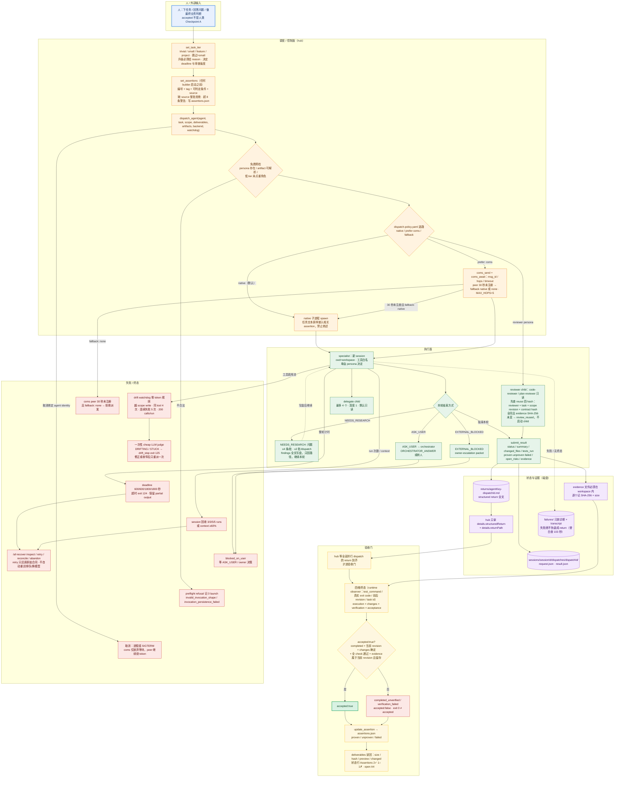

# Agent Fleet 到底怎么跑起来

> 依据：本地 clone `/tmp/refs-agent-fleet`（commit `8391895`）的 README、`dispatch-*.ts`、`specialist-result.ts`、`acceptance.ts`、`assertion-ledger.js`、`coms-envelope.ts`。文档与源码有出入的地方以源码为准，并明确标注。

## 1. 一句话

一个很薄的调度员（dispatcher，代码里叫 hub）守住任务目标和一张验收清单，把具体工作分给上下文独立、工具受限的 specialist；specialist 有的是本机子进程，有的是长期在线的 peer，所有大块产出都落到磁盘，hub 只拿摘要和路径。

## 2. 编制

- **人**：在 Pi 会话里下任务、回答问题、做最终判断。
- **hub / dispatcher**：同一个 Pi runtime 的两种工作模式。**operator** 保留直接读写代码的工具；**orchestrator** 拿掉 edit/write，只留派活、研究、断言、只读巡检、coms 和 Herdr。不是两个进程，是同一会话换工具集。
- **persona**：角色定义，决定“谁”以及能用哪些工具。builder、test-engineer、documenter 可写；code-reviewer、plan-reviewer、security-auditor、researcher 只读；planner 只写 plan 文件。
- **roster（团队）**：`.pi/agents/teams.yaml` 里的一串 persona 名单，不是进程。团队只规定“这次可派谁”，真正 dispatch 到某人才启动一个 native specialist 子进程。
- **peer**：`.pi/agents/peers.yaml` 里长期运行的独立进程（Pi 或 Claude Code），有稳定的 coms 名字。它和同名 persona 可以互相替代，但运行方式写在 peers.yaml。
- **临时角色**：`spawn_research` 起的只读研究 helper；specialist 用 `delegate` 再往下派的 child（一层，最多 4 个，默认只读）。
- **能不能兼任**：一个会话不能同时扮演两个 persona。但同一个“名字”可以按每次 dispatch 决定走 native 还是 coms；operator 模式的 hub 自己既能写代码又能派活，这是唯一的兼任。

## 3. 一次任务从开始到结束

1. 人给 hub 一段任务。hub 先 `set_task_tier` 分成 trivial/small/feature/project；跳过等于 small，升级必须给 reason。tier 决定子任务时限和审查强度，不决定用谁。
2. hub 在**任何 builder 启动之前**用 `set_assertions` 写验收清单。每条有编号、tag（test/runtime-ui/code-grep/manual）、一个可判定的通过条件和 `source`（需求出处）。缺 source 整批拒绝；一次开放超过 8 条只警告。清单存盘。
3. hub 调 `dispatch_agent(agent, task, scope, deliverables, artifacts, backend, watchdog)`。派活前免费预检：persona 是否存在、artifact 能否解析、低 tier 是否点了重角色。不合法返回 `invalid_invocation_shape`，合法但持久化失败返回 `invocation_persistence_failed`，都不启动执行者。
4. 选载体看 `.pi/agents/dispatch-policy.yaml`：默认 native；某成员可 `prefer: coms`，`fallback: native|none`；`none` 时先等 30 秒看 peer 是否注册，等不到就拒绝。任务文本里必须把相关断言**原样**放进去，不能转述。
5. 执行者在新 session 里工作。它可以中途以 `NEEDS_RESEARCH: 问题`、`ASK_USER: 问题`、`EXTERNAL_BLOCKED: ...` 结束本轮；hub 在代码层拦截这些标记，研究问题最多 4 条一批、每次 dispatch 最多 2 批，findings 写盘后只把路径发回去继续。
6. 收尾必须调 `submit_result`：status、summary、changed_files、assertions_proven/unproven/failed、tests_run、open_risks、requires_user_decision、evidence。每条 proven 必须指到本次 evidence 数组里的文件；文件必须在 workspace 内，逐个记 SHA-256 和大小。没有 evidence 的“proven”会被降级。
7. hub 机器解析这份 return。全文写到 `.pi/agent-sessions/sessions/<sessionId>/artifacts/returns/<agentKey>-<dispatchId>.md`；给 dispatcher 的只有 `details.structuredReturn` 摘要和 `details.returnPath`。缺 assertion id 或证据的条目会打 `contractNotices`。
8. runtime 自己记执行证据：native 子进程通过 bash 跑 `test_command` 时，observer 记录命令、真实 exit code、执行前后 revision，并绑定 task id。改了文件但编译报错，会把本次 dispatch 的 proven 降级。
9. hub 计算 `agent-fleet.runtime-result/v1`：execution（completed/failed/pending）× changes（changed/unchanged/unknown，加 certain/uncertain/not_observed）× verification（passed/failed/missing/stale/unsupported）× acceptance（accepted/not_accepted）。只有 execution 完成、任务仍是当前 revision、changes 确定、所有 requirement/check 通过、证据属于当前 revision 且留存，才 `accepted:true`。
10. hub 用 `update_assertion` 把清单标成 proven/unproven/failed，并给用户一行 `Assertions: 2✓ 1○ 1✗ · open: A4`。`deliverables` 里的每个精确文件会被读回，记录大小、hash、预览和是否 changed；不存在或没变都不算交付。
11. 验收由 hub runtime 计算，但最终业务判断仍归人。Verification Contract 是 **advisory** 的：hub 不会因为断言没 proven 就硬拒绝下一次 dispatch；硬的是 return 解析和 acceptance 计算。

## 4. 任务和状态记在哪

- **验收台账**：`.pi/agent-sessions/assertions.json`。hub 写；specialist 只从任务文本里看到相关断言，不能改台账。
- **每次 dispatch**：`.pi/agent-sessions/sessions/<UUID>/dispatches/<UUID>/request.json` 和 `result.json`，创建即独占。request 留任务与输入 artifact 副本，result 留输出、诊断、transcript 路径。
- **产物目录**：`returns/`、`failures/`、`plans/`、`reviews/`、`inventories/`、`evidence/` 分开。失败只能写 `failures/`，绝不伪装成 return——源码注释记录过一个 coms error stub 被当成 reviewer return，导致下一次 dispatch 白查 103 秒。
- **恢复**：状态行很短，compaction 后 hub 必须用 `get_assertions` 读回全文再 gate。orchestrator 自读有 64 KiB/turn 上限，超了就分页或派 helper。
- **失败/暂停**：`execution: pending`、`verification: missing|stale`、`changes: uncertain`、`accepted:false` 都表示没完成；`blocked_on_user` 表示等人回答。

## 5. Agent 之间怎么通信

- **native**：父进程 spawn 子进程，结果通过结构化 return 回来，本质是同步请求/响应。
- **coms**：同机 unix socket 或 named pipe，按 project 注册。envelope 带 `msg_id`、`sender_session`、`hops`、`prompt`、`response_schema`、`reply_timeout_ms`。`MAX_HOPS=5`，默认超时 30 分钟。
- `coms_send` 发出后拿 `msg_id`；`coms_await` 阻塞等这个 id 的回包；`coms_get` 非阻塞查 `pending|complete|error`。Herdr 环境用 `events.subscribe` 收 pane 状态变化，避免每 10 秒 ping。
- 消息里必须有的：目标 peer、任务、以及“按结构化 return 格式回复”的约束。peer 只收到一段 user prompt，所以 dispatch 协议是塞在消息正文里的。
- hub 等所有并行 dispatch 的 return 到齐才进验收门；`/af-handoff` 把整个会话交给 peer：hub 写“假设对方没有共享历史”的 brief，机器再追加当前 ledger 原文和 artifact index，然后 send + await。
- **缺 sentinel 本身就是结论**：按失败/unknown 处理，绝不按成功。只 grep 最后几行，防止 agent 在正文里“提到”标记。

## 6. 怎么判断“干完了”

三层证据缺一不可：结构化 return + 具名 evidence；runtime observer 的命令/退出码/revision；deliverables 的读回结果（大小、hash、预览、changed）。

终态是四维正交的。**exit 0 只等于 execution completed，不等于 accepted**；没有合格的运行时检查时是 `completed_unverified` 或 `verification_failed`，`accepted:false`。`needs_verification` 的意思是“未被接受”，不是“快好了”。

两个必须知道的偏差：第一，验证是 advisory 的，hub 不会因未 proven 阻断派活；第二，specialist 自己写的测试也可能通过 runtime gate，runtime 只证明执行和状态，不证明测试语义充分。`accepted` 也不是人类 Checkpoint A。

审查复用有条件：同一 reviewer、同一 task、同一 scope revision、同一 contract hash、evidence 文件 SHA-256 未变，才 `review_reused` 且不启动 child；任一输入、源码、需求、scope 变化或存在 blocking finding，都必须重审。

## 7. Agent 跑在哪、能碰什么

- native child 是本机子进程，cwd 是当前 workspace，工具白名单由 persona 决定。orchestrator 自己没有 edit/write。
- `assist.write-isolation: true` 时，dispatch 前 snapshot，子进程用 bubblewrap（Linux）或 Seatbelt（macOS）包起来：repo 只读，只允许显式 exact file、显式 recursive dir 和本次 runtime 目录。沙箱起不来就 fail closed，不做 unsandboxed retry。exact-file grant 会故意挡住 temp-file+rename 的原子保存。
- coms peer 是独立进程，不在 hub 的沙箱里；hub 只能发消息，杀不掉它。
- worktree targeting 是把 session 绑到某个已注册 checkout，属于路由，不是 OS 沙箱。`scope` 只是 advisory：越界只产生 `details.scopeViolations` 和警告，不 block、不 revert。真正强制的是 flow 层的 writes policy：缺 policy 在 spawn 前拒绝，phase 前后做 snapshot diff，越权改动回滚并判失败。
- damage-control 用正则拦 `rm -rf`、`git reset --hard`、`git push --force` 等；safety plumbing 缺失时直接拒绝子 dispatch。

## 8. 卡住、失败、换人怎么办

- task tier 给整轮 deadline（600/600/1800/1800 秒），超时 exit 124 并保留 partial output；session 在 3/3/5/5 次运行后或 context ≥60% 时回收。
- **drift watchdog**：第一层零 token 的确定性规则——越 scope 的 write/edit、同一 tool call 重复 4 次、连续 5 次 tool 失败、单 run 200 次 tool call。命中才升级给一次性 cheap LLM judge，判 `DRIFTING`/`STUCK` 就 `drift_stop` 终止（exit 125）。指令是“修正或收窄任务后只重派一次，不要原样重试”。
- **不自动重试、不排队、不自动换模型**。preflight refusal 记 0 launch；settled indeterminate 失败最多允许一次人类显式授权 retry，且可能重复副作用。`/af-recover inspect|retry|reconcile|abandon`：retry 只把原始合同还给你，不自己执行。
- **取消**绑定 agent identity，task reset 不清除 fence。native 是进程组 SIGTERM；coms-backed 只是放弃等待，peer 继续烧 token。
- **换人**：`/af-agents-restart` 用新上下文重跑最后一个 task；research helper 不能 resume，每次新建 `rN`；delegate 最多 4 个 child、深度 1，默认只读。
- **升级到人**：`ASK_USER` 先到 orchestrator，orchestrator 能用 `ORCHESTRATOR_ANSWER`（basis 为 existing_decision/repository_fact/routine_technical）回答就回答，答不了才转给人。`EXTERNAL_BLOCKED` 触发 owner-escalation packet：缺什么、谁负责、哪些断言被卡、人类有哪些选项。

## 9. 这套舰队的真正特点

1. **薄调度、厚磁盘**：hub 的上下文是稀缺资源，研究全文、return 全文、审查证据全部落盘换路径和摘要。这让任务能活过 compaction，也让调度员不会被细节淹没。
2. **验收是运行时产物，不是口气**：结构化 return、证据哈希、revision 绑定、四维终态，把“模型说完成了”与“系统接受”拆开。
3. **角色与载体分离**：persona 决定“谁”，teams.yaml 决定“团队”，peers.yaml 决定“怎么跑”，dispatch-policy 只决定“何时用 peer”。换载体不改流程。
4. **代价**：控制面很重，和 pi 绑得很深，不少机制是 advisory 或实验性的；文档与源码漂移是真实风险。hub 越薄，前期制度成本越高。

## 10. 对我们的三点启发

1. **先定“完成的证据形状”，再写调度**：acceptance 必须是带 revision 和 evidence path 的运行时记录，任何“完成”消息都要能指到具体文件和命令。这样多 agent 才不能靠互相转述“我觉得好了”往前推。
2. **调度者只拿摘要和路径**：ledger 存盘、return 全文落盘、状态行进上下文，并给自读设硬上限。超过上限就派研究或派 specialist，而不是把正文塞进 hub。这是可直接照搬的上下文纪律。
3. **把角色、名单、载体、路由拆成四个东西**：persona、team、carrier、dispatch policy 分开定义；先只实现 native 一条路，但把 `backend` 选择和 fail-closed 语义留好。再补一条“缺 sentinel 即失败”，成本很低，收益很大。

## 11. 关键文件索引

以下路径相对本地 clone `/tmp/refs-agent-fleet`：

- `.pi/harnesses/agent-hub/README.md` — dispatch 全流程、Verification Contract、watchdog、coms
- `.pi/harnesses/agent-hub/specialist-result.ts` — `submit_result` 的字段、证据校验与大小上限
- `.pi/harnesses/agent-hub/acceptance.ts` — 四维终态与 `accepted` 的判定条件
- `.pi/harnesses/agent-hub/assertion-ledger.js` — 断言必须有 source 与 8 条软上限
- `.pi/agent-fleet/scripts/lib/coms-envelope.ts` — coms envelope、hop 上限、超时
- `.pi/agents/dispatch-policy.yaml` / `.pi/agents/peers.yaml` — native/coms 路由与 peer 定义

## 12. 详细流程图

> 下图只使用本文 1–11 节已核对源码的事实；节点中的文件、状态值、阈值与失败原因均可在正文或源码索引中找到出处，未核实的细节不画。

