# ADLC Fleet 到底怎么跑起来

> 依据：本地 clone `/tmp/adlc-repo`（commit `b002ecb`）的 `packages/fleet`，重点读了 `run.mjs`、`scheduler.mjs`、`plan.mjs`、`gate-pipeline.mjs`、`prosecute.mjs`、`worktrees.mjs`、`lock.mjs`、`resume.mjs`、`sandbox.mjs`、`preflight.mjs`。版本假设以该 commit 为准。

## 1. 一句话

把 `.adlc/tickets.json` 里的 ticket DAG 当输入，一个纯代码的调度器按依赖、scope 冲突和并发槽挑出 ready 票，每票派一个全新上下文的 worker 在独立 worktree 里做；确定性门禁和跨模型对抗审查都过了，才按顺序合入本轮集成分支，最后只开一个 PR 交给人。

## 2. 编制

- **operator（人）**：配置、批准、最终 P6 合并。危险开关只认命令行参数，不认仓库里的配置。
- **fleet orchestrator（代码）**：读 DAG、选票、建 worktree、commit、merge、写状态。它不调用 LLM 做任何排序、重试或合并决定。
- **worker（builder）**：无头 Claude Code 或其他 adapter，一票一个上下文，在自己的 worktree 里改代码。它不 commit，最后一个输出行必须是 `TICKET-DONE` 或 `TICKET-BLOCKED: <reason>`。
- **确定性门禁（代码）**：build/test、scope、受控文件完整性、rails-guard。它们不是角色，是流水线里的检查站。
- **prosecutor**：用新鲜上下文、优先不同 provider 跑 `adversarial-review`，对 ticket-local diff 做阻断式审查。
- **辅助角色**：merge-forecast 在跑前给一份证据（advisory，不是第二套强制）；quartermaster 可选地按票挑 adapter 和模型（fail-closed）。
- **票从哪来**：人和 ticket shaping 工具在 fleet 之前写好，fleet 只消费 DAG。fleet 里没有“拆票”这个 LLM 角色。
- **能不能兼任**：worker 一次只做一票；prosecutor 必须独立于 builder；orchestrator 不评价代码。冲突不靠“谁让一下”，而是在调度层用 scope 分区提前消掉。

## 3. 一次任务从开始到结束

1. 读 `.adlc/tickets.json`。`completed:true` 的票不执行，但仍满足依赖边；边方向是前置 → 后继。
2. `fleet run` 做 preflight：必须配了 gate 的 build 或 test，否则拒绝；探测 bwrap / sandbox-exec，没有后端就 fail closed；原子拿 `.adlc/fleet.lock`；主 checkout 必须干净；rail-hook 探针缺失大声警告；canary 在一次性目录里跑一条 allowlist 命令，证明权限管道通；`adlc merge-forecast --json` 只记证据。
3. 建本轮集成分支 `fleet/run-<runId>`（从 base SHA 起），并给它一个专属 worktree `.worktrees/fleet-integration`。base 永远不写。
4. `planRound` 算 ready：票未完成、所有前置已 merged 或 completed、scope 与任何 in-flight 票不重叠、还有空槽（默认并发 2）。满足就标 `building` 并占槽。
5. 开票 worktree `.worktrees/fleet-<id>` 和分支 `fleet/<id>`，从集成分支当前 tip 切出，记下 `startSha`。之后所有 scope 检查和审查都 diff 这个起点，不是 base。
6. worker 收到 charter：票的 spec 被 fence 包住；constraints 明确只能碰 scope 内文件、rails 只读、不要 commit、gate 命令自己先跑。它改代码、跑测试，最后只留 `TICKET-DONE` 或 `TICKET-BLOCKED`。
7. orchestrator 用 `git add -A -- :!.claude :!.adlc` 把 worker 改动提交；然后是 gating。
8. 确定性门禁按顺序跑，第一个失败就停：sandbox 里 build/test → `git diff --name-only startSha..HEAD` 的每个路径匹配 ticket scope → `.claude/**`、`.adlc/**` 受控文件完整性扫描（含 `tickets.json` 这个信任根；`.adlc/fleet-logs/**` 是唯一惰性白名单；“git 列为改动但读不到”也算违规）→ `adlc rails-guard --base startSha --ticket`。
9. prosecuting：对 `startSha..HEAD` 跑真实的 `adversarial-review`，新鲜上下文，尽量不同 provider。达到 `prosecuteFailOn`（默认 medium）就转 fixing，而不是合并；没有可用 provider 则 `unavailable`，fail closed。
10. merging：在进程内 merge mutex 里严格串行。票分支先 rebase 到集成分支 tip，再 `--no-ff` merge，记 `mergeSha` 和 `preMergeSha`；在集成分支跑 post-merge gate。失败就回滚：HEAD 仍是那个 merge commit 才 reset，否则 revert 并把分支标记为 quarantine。
11. 合并通过后，用与 `adlc ticket complete` 同一条路径把票标成 completed，并对这个完成 commit 再跑一次 gate；失败就撤掉完成 commit，票停在 merged-not-completed。
12. 全部结束后，只有确实有票 merged 且分支没被 quarantine，才 `gh pr create` 开一个 PR。fleet 不 push base。人做 P6。

## 4. 任务和状态记在哪

- **状态文件**：`.adlc/fleet-status.json`（schemaVersion 1）。记 runId、base、baseSha、集成分支、并发度、sandbox 模式，以及每票的 state、strikes、branch、startSha、reason、reasonCode、prosecution、review。每次状态变化用 temp + rename 原子写。
- **状态机**：`pending → building → gating → prosecuting → fixing → merging → merged`；终态是 `failed | blocked`；`paused` 是旁支，表示 quota 或 wall clock 暂停，重新调用会 reconcile 回 `pending` 且保留 strike。
- **git 是事实源，status 只是缓存**。恢复时用 `merge-base --is-ancestor` 判断票分支是否已经进了集成分支；集成分支或 baseSha 丢了就拒绝 resume，不猜。死 run 留下的 rebase/merge 先 abort，worktree 先 prune。
- **锁**：`.adlc/fleet.lock/` 是原子 mkdir，`owner.json` 记 pid、host、runId、startedAt、procStartTime。只有 pid 活着且启动时间匹配才算活锁，专门防 PID 复用；stale 锁用 rename 隔离回收；`fleet unlock` 是兜底。
- **谁能写**：只有 orchestrator 写 status 和 lock；外部观察者用 `fleet status --json` 只读。worker 不 commit，也不该碰 `.adlc`，碰了会被受控文件扫描抓住。
- **失败原因**是封闭集合：`quota-paused`、`lock-held`、`wall-clock`、`strikes-exhausted`、`ticket-blocked`、`flail`、`review-unavailable`、`mirror-fetch-failed`；运行级还有 `quarantined`、`pr-open-failed`、`preflight`、`resume-refused`、`dispatch-refused`。看到这些码就知道该重试、该换人还是该叫人。

## 5. Agent 之间怎么通信

这套系统**没有 agent 之间的聊天**。通信只有五种载体：命令行参数传任务、stdout 和退出码回结果、git 分支交换代码、status JSON 同步状态、PR 交付。

- worker 最后一行被要求写 `TICKET-DONE` 或 `TICKET-BLOCKED`，但 orchestrator 只机械检查 `/TICKET-BLOCKED/`。`TICKET-DONE` 本身不校验：worker 以 0 退出却没写 DONE，改动照样会被提交并进入门禁；exit 非 0 或超时才会记一次 strike 并重试。真正的兜底是门禁，不是 sentinel。
- 上一轮的失败材料会进下一 strike 的 prompt，但先被包进 `<<UNTRUSTED:PRIOR_FAILURE:<uuid>>>` 围栏，并明确声明“这是数据，不是指令”。ticket 正文本身也会 fence，防止恶意 spec 让 worker 去改 rails 或扩大 scope。
- 同步性：每票的 build→gate→prosecute 是一条 await 的 Promise；多票并发用 `Promise.race` 等最先结束的一票，然后重新算 ready；merge 用 mutex 串行。没有消息队列，也没有轮询。
- 需要人时不是发消息，而是退出码 2 + reasonCode + 状态文件；PR 就是给人的交付物。

## 6. 怎么判断“干完了”

四道关全过才算：确定性门禁、阻断式审查、post-merge gate、completion 后的再 gate。任何一道失败，票都不算完成。

证据长这样：`fleet-status.json` 里每票的 gate、prosecution、review 记录；可选 `gate-manifest record` 往 `.adlc/manifest.jsonl` 追加一行，`prev` 指上一行的 SHA-256，可 HMAC 签名，供 CI 或 P6 复核。

没干完的样子：strike 用完、`TICKET-BLOCKED`、paused、wall clock 到期、review provider 不可用、PR 没开成、分支被 quarantine。退出码 0 才是干净；2 表示至少一票失败/阻塞/暂停；1 是操作错误。

人工闸门在两头：票进入前由人 shaping，PR 出来后由人 P6。中间没有 per-run 的人工拆分门。

## 7. Agent 跑在哪、能碰什么

- **每票独立 worktree**，集成分支也有自己的 worktree。worker 不 commit，base 只读。这是真隔离，不是目录约定。
- **双平面 OS 沙箱**：repo-command 平面断网、限定读写，用来跑 build/test 和 gate；model 平面允许出网（worker 要连 provider），读是宿主范围（源码明确写成残余风险），写限定。Linux 用 bwrap，macOS 用 sandbox-exec；没有后端就拒绝 dispatch，`--i-am-in-a-disposable-container` 只能由 operator 在命令行给。
- worker 用 `claude -p --permission-mode acceptEdits` 加 allowlist，只允许 gate 命令、配置里的 allowedCommands 和只读 git；不允许 `dangerously-skip-permissions`；默认不允许 commit 和 install。
- 环境变量会剥离 provider key 和 `ADLC_*`；model 平面拿不到 manifest key。仓库配置是攻击面：adapter、model、allowlist 这些只有 operator 本地能给，仓库里写了会警告并忽略，避免候选树自己选裁判。

## 8. 卡住、失败、换人怎么办

- **strike**：默认 2 次（1..50）。同一票的多个 strike 复用同一个 worktree；这个 commit 里 `resetWorktree`（`checkout -- .` + `clean -fd`）只有定义、没有任何调用点，所以上一轮改动不会被自动清掉。第 2 次 strike 的修复 prompt 会带上围栏化的上一轮诊断和审查发现。
- **flail-detector**：两轮之间判断是否在原地打转；真 flail 会跳过下一次 strike。它 fail-open：信号不可用就按正常重试走，但会打 warning，不会假装“干净”。
- **wall clock** 是整轮绝对截止。超时杀进程组，记 `wall-clock`，exit 2；原样重跑同一条命令就能续，strike 会交回。`quota-paused` 同理。
- `lock-held` 是稍后重试；`strikes-exhausted`、`ticket-blocked`、`flail`、`review-unavailable`、`mirror-fetch-failed` 对该票是终态。
- **换人**：每票、每次 strike 都是新 worker、新上下文，没有交接单；交接物就是 ticket 正文加围栏化的失败材料。quartermaster 可以按票换 adapter/model，但配置错误时 fail-closed。
- **恢复**：没有 `--resume` 参数，重跑同一个命令即可。reconcile 用 git 事实源判断已合并还是回 pending；worktree 脏、集成分支丢失、baseSha 不可达都会拒绝恢复，不猜、不自动清理可能藏有证据的目录。

## 9. 这套舰队的真正特点

1. **控制流和判断彻底分开**：排序、重试、合并全是代码，模型只负责写代码和理解失败材料。这让行为可复现，也让“谁先合”不再是一次 LLM 抽奖。
2. **冲突在调度层消灭**：scope 重叠的票根本不会同时跑，单写者分区；合并严格串行。它不解决冲突，而是让冲突不发生。
3. **验收链独立且阻断**：builder 不能自证，门禁是代码，prosecutor 用新上下文和不同模型；拿不到审查就拒绝合并，绝不静默放行。
4. **代价**：环境要求高（OS 沙箱、干净树、第二个 provider），scope 写不准会让门禁和串行化同时失效。流程重，适合有明确 ticket 的批处理，不适合探索性工作。

## 10. 对我们的三点启发

1. **用 DAG + scope 分区做调度，不要让 LLM 排优先级**：ready 条件、并发槽、单写者都能写成纯函数并单测，行为可复现，也容易解释“为什么这票还没跑”。
2. **验收必须是独立、可执行的链条**：worker 只产出 diff，gate 由另一层代码跑；审查者用新上下文、最好不同模型；拿不到审查就拒绝合并，而不是静默放行。
3. **恢复靠 git 事实 + 带进程启动时间的锁 + 封闭 reason code**：状态文件只是缓存，随时能用 `merge-base --is-ancestor` 重建；所有“暂停”都必须能用同一条命令重跑。这套做法比复杂的断点续传可靠。

## 11. 关键文件索引

以下路径相对本地 clone `/tmp/adlc-repo`：

- `packages/fleet/lib/run.mjs` — 并发池、合并编排、PR 与 quarantine
- `packages/fleet/lib/scheduler.mjs` — 单票状态机、strike、暂停与恢复 reconcile
- `packages/fleet/lib/plan.mjs` — ready 集合、scope 重叠串行、并发槽
- `packages/fleet/lib/gate-pipeline.mjs` — build/test、scope、受控文件、rails 的顺序执行
- `packages/fleet/lib/lock.mjs` — 原子 lock、PID 复用防护、stale 回收
- `packages/fleet/lib/sandbox.mjs` — 双平面、bwrap/Seatbelt、fail-closed

## 12. 详细流程图

> 下图只使用本文 1–11 节已核对源码的事实；节点中的文件、状态值、阈值与失败原因均可在正文或源码索引中找到出处，未核实的细节不画。

```mermaid
flowchart TD
  subgraph HUMAN["人 / 外部输入"]
    H1["人 + ticket shaping 工具：先写好 .adlc/tickets.json<br/>fleet 只消费 DAG，不拆票<br/>operator 用 CLI 给危险开关，最后做 P6"]
  end

  subgraph CONTROL["调度 / 控制面（纯代码 orchestrator）"]
    C1["读 .adlc/tickets.json<br/>completed:true 不执行，但仍满足依赖边<br/>边方向：前置 → 后继"]
    C2{"fleet run preflight<br/>build 或 test gate 已配置?<br/>bwrap / sandbox-exec 可用? 主 checkout 干净?"}
    C3["原子 mkdir .adlc/fleet.lock/<br/>canary 在一次性目录跑 allowlist 命令<br/>rail-hook 探针缺失大声警告"]
    C4["建集成分支 fleet/run-runId（从 base SHA）<br/>+ worktree .worktrees/fleet-integration<br/>base 永远不写"]
    C5["planRound 算 ready<br/>未完成 + 前置 merged/completed +<br/>scope 不重叠 + 有空槽（默认并发 2）"]
    C6["标 building 并占槽<br/>开票 worktree .worktrees/fleet-id<br/>分支 fleet/id 从集成 tip 切，记 startSha"]
  end

  subgraph EXEC["执行面"]
    E1["worker：headless Claude Code / adapter<br/>一票一上下文，在自己的 worktree 里改代码"]
    E2["charter：spec 用 fence 包住<br/>只碰 scope · rails 只读 · 不 commit · 先跑 gate 命令"]
    E3["最后一行 TICKET-DONE / TICKET-BLOCKED: reason<br/>orchestrator 只机械检查 /TICKET-BLOCKED/"]
    E4{"worker 退出：exit code / 超时?"}
    E5["git add -A -- :!.claude :!.adlc<br/>把 worker 改动提交"]
    E7["quartermaster：按票挑 adapter / model<br/>配置错误 fail-closed（可选）"]
  end

  subgraph STATE["状态与证据（磁盘，orchestrator 独占写）"]
    D1[(".adlc/fleet-status.json<br/>state / strikes / branch / startSha / reason / reasonCode")]
    D2[(".adlc/fleet.lock/owner.json<br/>pid + host + runId + procStartTime")]
    D3[("git 是事实源：分支 / worktree / merge-base<br/>status 只是缓存")]
    D4[(".adlc/manifest.jsonl<br/>prev = 上一行 SHA-256 · 可 HMAC 签名")]
  end

  subgraph GATE["验收门"]
    G1["门禁 1：sandbox 内 build/test<br/>repo-command 平面断网、限定读写"]
    G2["门禁 2：scope<br/>git diff --name-only startSha..HEAD 逐路径匹配"]
    G3["门禁 3：受控文件完整性<br/>.claude/** · .adlc/**（含 tickets.json 信任根）<br/>fleet-logs/** 白名单 · 读不到也算违规"]
    G4["门禁 4：adlc rails-guard --base startSha --ticket"]
    G5{"四道门禁全过?<br/>第一个失败就停"}
    G6{"prosecution ≥ prosecuteFailOn?<br/>默认 medium"}
    E6["prosecutor：adversarial-review<br/>新鲜上下文 · 尽量不同 provider<br/>审查 startSha..HEAD 的 ticket-local diff"]
  end

  subgraph MERGE["合并 / 交付（串行）"]
    M1["merge mutex 内严格串行<br/>票分支先 rebase 到集成 tip<br/>再 --no-ff merge，记 mergeSha / preMergeSha"]
    M2["post-merge gate @ 集成分支"]
    M3["adlc ticket complete 同一路径 + 再 gate<br/>失败撤完成 commit → merged-not-completed"]
    M4{"全部结束：有 merged 且分支未 quarantine?<br/>否 → 重算 planRound · 是 → PR"}
    M5["gh pr create 一个 PR，fleet 不 push base<br/>PR 交给人做 P6"]
  end

  subgraph FAIL["失败 / 终态"]
    F1["strike 默认 2（1..50）<br/>同一票复用同一 worktree · resetWorktree 无调用点"]
    F2["第 2 strike prompt 带 UNTRUSTED:PRIOR_FAILURE 围栏<br/>flail-detector 判断原地打转：fail-open + warning<br/>下一 strike 用新 worker 重跑，复用同一 worktree"]
    F3["wall clock 绝对截止 → 杀进程组<br/>reason wall-clock · exit 2"]
    F4["quota-paused 暂停<br/>重跑 reconcile 回 pending · 保留 strike"]
    F5["reconcile：merge-base --is-ancestor<br/>已合并 → merged；否则 → pending"]
    F6["lock-held 稍后重试<br/>PID 复用防护 · stale 锁 rename 隔离"]
    F7["resume-refused：baseSha / 集成分支丢失<br/>脏 worktree · 不猜、不自动清理"]
    F8["失败汇总：封闭 reason 集合 + 退出码<br/>quota-paused / lock-held / wall-clock / strikes-exhausted /<br/>ticket-blocked / flail / review-unavailable / mirror-fetch-failed<br/>运行级：quarantined / pr-open-failed / preflight /<br/>resume-refused / dispatch-refused<br/>票失败/阻塞/暂停 → exit 2；操作错误 → exit 1；0 才是干净"]
    G7["无可用 provider → review-unavailable<br/>fail closed，不静默放行"]
    F9["quarantine：HEAD 仍是 merge commit 才 reset<br/>否则 revert 并把分支隔离"]
    F10["merged-not-completed<br/>完成 gate 失败 → 撤完成 commit"]
    F11["gating 停：第一个失败即停<br/>本次不进入合并"]
    F12["fixing：prosecution 达到阈值<br/>带审查发现修，不合并"]
  end

  H1 --> C1
  C1 --> C2 --> C3 --> C4 --> C5 --> C6
  C3 -- "lock 被占" --> F6
  C6 --> E1
  C6 -. "可选" .-> E7
  E1 --> E2 --> E3 --> E4
  E4 -- "exit 0 / 未写 DONE 也提交" --> E5
  E4 -- "exit≠0 / 超时" --> F1
  E5 --> G1 --> G2 --> G3 --> G4 --> G5
  G5 -- "否：第一道失败即停" --> F11
  G5 -- "是" --> E6 --> G6
  G6 -- "≥ medium" --> F12
  G6 -- "低于阈值 / 通过" --> M1
  G6 -- "unavailable" --> G7
  M1 --> M2 --> M3 --> M4
  M2 -- "失败" --> F9
  M3 -- "gate 失败" --> F10
  M5 -- "pr-open-failed" --> F8
  M4 -- "是" --> M5
  F1 --> F2
  F3 --> F5
  F4 --> F5
  F5 -- "分支/工作树不可恢复" --> F7

  M5 ~~~ D1 ~~~ D2 ~~~ D3 ~~~ D4
  M5 ~~~ F1 ~~~ F2 ~~~ F3 ~~~ F4 ~~~ F6 ~~~ F7 ~~~ F9 ~~~ F10 ~~~ F11 ~~~ F12 ~~~ F8

  classDef human fill:#E8F0FE,stroke:#1A73E8,color:#0B2A5B,stroke-width:2px
  classDef control fill:#FFF3E0,stroke:#E8710A,color:#5C2A00
  classDef exec fill:#E6F4EA,stroke:#137333,color:#0B3D1E
  classDef state fill:#F3E8FD,stroke:#8430CE,color:#3C0D63
  classDef gate fill:#FEF7E0,stroke:#F9AB00,color:#4A3000
  classDef fail fill:#FCE8E6,stroke:#C5221F,color:#5C0B09
  classDef ok fill:#D9F2E3,stroke:#0F9D58,color:#08421F,stroke-width:2px

  class H1 human
  class C1,C2,C3,C4,C5,C6 control
  class E1,E2,E3,E4,E5,E7 exec
  class D1,D2,D3,D4 state
  class G1,G2,G3,G4,G5,G6,E6 gate
  class M1,M2,M3,M4,M5 control
  class F1,F2,F3,F4,F5,F6,F7,F8,F9,F10,F11,F12,G7 fail
```

