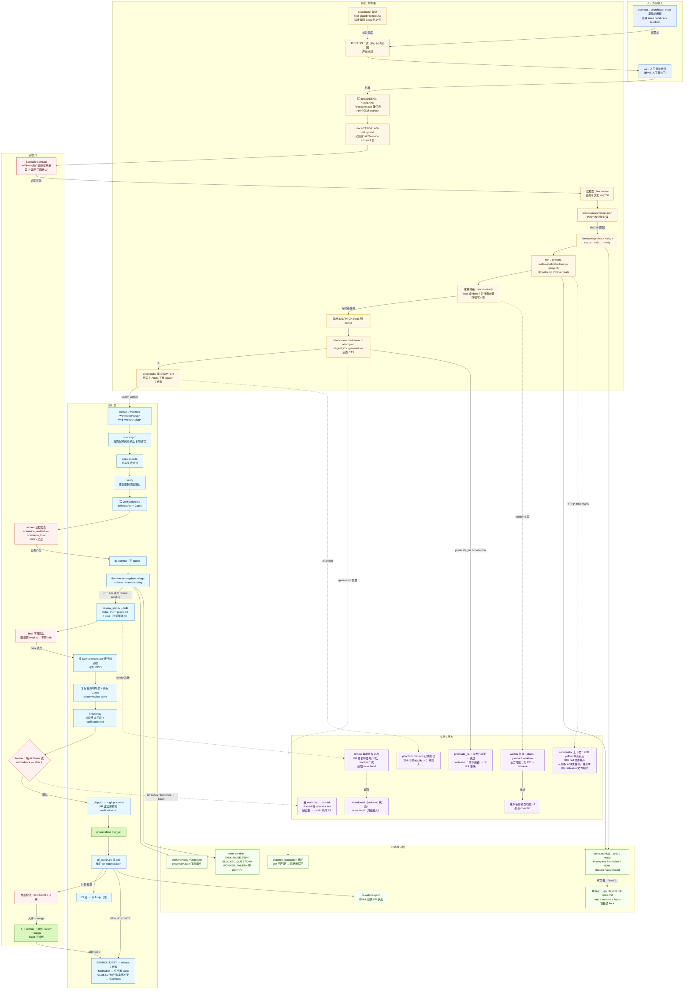

# Fengshen Fleet 到底怎么跑起来

> 依据：本地 clone `/tmp/fs-fleet-src`（edisonshen/fleet）的 README、`skills/coordinator/SKILL.md`、`skills/fleet-guard/SKILL.md`、`docs/STATE.md`、`internal/tasks/tasks.go`、`skills/coordinator/loop.py`、`pr_watch.py`。注意阈值漂移：官网写 50%/70%，当前源码是 40%/50%，本文以源码为准并标注。

## 1. 一句话

Fleet 是“每个项目一个包工头”的舰队：一个常驻 coordinator 只负责讨论、拆任务、派活、盯 PR，绝不写代码；每个任务按“工人 → 双审查 → 交付员”三段走，工人在自己的 git worktree（同一仓库分出来的独立工作目录）里干活；所有状态写在 `~/.fleet` 的扁平文件里，TUI 只是看板。

## 2. 编制

- **operator（人）**：在 TUI 或 coordinator 的 tmux 会话里提需求、批准计划、决定升级项；不直接调度。
- **coordinator**：每个项目一个，常驻。拥有 `tasks.md`，但只能通过 `fleet tasks` CLI 改。规划、拆分、派发、看 PR。不实现、不做内联 review。
- **worker**：临时子代理（Claude 的 Agent 工具或 codex 的 `spawn_agent`），一个任务一个，独立 worktree。
- **reviewer**：临时子代理，alpha/beta 两席。beta 是主引擎锚点，必须通过；alpha 是另一家 provider，没装就退化为第二个主引擎模型。
- **finisher**：不是子代理，是 coordinator tick 里的确定性脚本 `finisher.py`。
- **planner**：任务超过 10 个时临时派一个，只负责产出任务列表。
- **fix / rebase 子代理**：PR 看护时临时派。

兼任规则：coordinator 不能兼 worker。`fleet-guard` 的 `PreToolUse` 钩子会拒绝它在 `docs/` 之外编辑文件、跑测试或执行改文件的 shell；子代理豁免。worker 不 push、不 review；reviewer 可以修 P0/P1，但修完必须复验。

## 3. 一次任务从开始到结束

1. 人在 coordinator 的 tmux 会话里描述问题。
2. **DISCUSS**：coordinator 读代码、问清范围，产出计划。这是唯一的人工批准门（G2）。
3. 人批准后，coordinator 写 `docs/DESIGN-<topic>.md`，再用 `fleet tasks add` 建任务。超过 10 个任务时先派 planner。每个任务要有 `docs/TASK-PLAN-<slug>.md`，里面必须有 `## Scenario contract` 表。
4. 所有任务计划先过双模型 plan review，结果带文档 sha256 存在 `~/.fleet/projects/
/plan-reviews/<slug>.json`；文档一改记录就失效。然后 `fleet tasks promote <slug>`，任务从 `todo` 变 `ready`。
5. tick（协调器的一次调度轮询，`python3 skills/coordinator/loop.py <project>`）重算就绪任务：`status=ready`、依赖都 `done`、并行槽未满、路径不冲突。它输出 DISPATCH block；coordinator agent 读到后先跑 `fleet claims mark-launch-attempted <agent_id> <generation>`，返回 `ok` 才真正 spawn 子代理。
6. worker 在 `~/.fleet/projects/
/worktrees/<slug>`（分支 `worker/<slug>`）里走 `spec-repro → spec-encode → verify`：先在跑起来的系统上复现错误，再写测试，再修。证据写进 `~/.fleet/projects/
/workers/<slug>/verification.md`，本地 commit，然后 `fleet workers update <slug> --phase review-pending` 退出。不 push。
7. 下一 tick 看到 `phase=review-pending`，派 reviewer。reviewer 用 `review_slot.py --both` 同时跑 alpha/beta，按 Scenario contract 检查证据，修 P0/P1，复跑受影响的场景和所有 Gates，写 `phase=review-done`。
8. 再下一 tick，`finisher.py` 校验 reviewer 的终态字段和 `verification.md`；缺证据就 block，不开 PR。通过则 `git push -u`、`gh pr create`，PR 正文原样附上 `verification.md`，最后写 `phase=done` 和 `pr_url`。
9. 之后每个 tick 维护 `~/.fleet/projects/
/pr-watches.json`：CI 红派 fix 子代理，BEHIND/DIRTY 派 rebase 子代理，MERGED 把任务置 `done`，CLOSED 未合并或实质冲突 raise hand。
10. 最终合并仍由 GitHub 的 CI 和人审完成，Fleet 不替代它们。

## 4. 任务和状态记在哪

- **账本**：`~/.fleet/projects/
/tasks.md`。状态七种：`todo / ready / in-progress / in-review / done / blocked / abandoned`。字段有 priority、depends_on、worktree、branch、pr_url、worker_pid、dispatch_generation、parked、complexity。
- **写者**：`tasks.md` 只允许 `fleet` CLI 写，coordinator 直接编辑会被拒绝；每个聚合一个写者。`agents/<id>.json` 只由该 agent 进程里的 fleet-guard 写。原子写是 `.tmp + rename`，持久事件再 fsync 文件与目录；项目级 flock 防止两个 tick 同时改。
- **其它状态**：`handoffs/`（交接文档）、`queue/spawn-fresh-*.json`（换人指令）、`inbox/`（消息）、`progress/*.jsonl`（追加事件）、`coord-state.json`、`workflow.md`、`pr-watches.json`。
- **暂停/失败**：`blocked` 需要 operator ack；`parked` 表示“这个脏 worktree 别动”；worker 失联会发 `WORKER_FAILED=` sentinel，带 `gen=<n>`，generation 对不上就忽略，防止旧任务写回新任务。没有全局 pause，靠 handoff 和次数上限。

## 5. Agent 之间怎么通信

没有 agent-to-agent 的直接消息总线。控制面是“文件 + 每 tick 重算”：

- tick 往 stdout 打 DISPATCH block，coordinator agent 读它并调用宿主的 Agent 工具，这是唯一能启动子代理的路径。
- 子代理完成后，宿主发 task-notification 给 coordinator；worker 的 phase 写在 `workers/<slug>/state.json`，coordinator 下一个 tick 读到就进入下一段。
- worker 结束时还会往 inbox archive 写 sentinel（约定格式的一行事件）：`TASK_DONE_PR=`、`BLOCKED_QUESTION=`、`WORKER_FAILED=`、`NEW_TASK=`。
- 人给 agent 的消息写 `~/.fleet/inbox/<id>.md`；fleet-guard 在 `Stop` / `SessionStart` hook 里注入，必要时用 `{"decision":"block","reason":...}` 让 agent 不要停。
- 协调是轮询式：每个 tick 重新对账，谁在飞、谁死了、PR 什么状态。没有阻塞等待，只有 flock 和 crash-safe 租约。

## 6. 怎么判断“干完了”

三把锁：

1. **Scenario contract**：一行一个用户可观察结果（响应体、文件内容、屏幕文本、exit code、DB 行、PR 状态），不能写“调用了函数 X”。Level 默认取项目 standards 的 Sandbox 最高档。
2. **worker 证据**：`verification.md` 必须有 `## Scenario contract`、`## Evidence — before`（证明原本会失败）、`## Evidence — after`、`## Gates`、`## Baseline`、`## Unit tests`；`scenarios_verified` 必须等于 `scenarios_total`，Gates 必须全过。
3. **外部检查**：reviewer 按合同逐行验，beta 不能跳过（限流算 blocked，不算 skip）；finisher 只看文件和字段，缺 `## Gates` 或 `## Evidence — after` 就 block。

所以“干完”不是 agent 说完成，而是 `tasks.md` 的 phase 到 `done` + `verification.md` 有证据 + PR 已开/已合。PR 合并仍要人。

## 7. Agent 跑在哪、能碰什么

- 每个 agent 一个 detached tmux 会话（后台终端）；coordinator 用 `claude --remote-control` 启动，手机 claude.ai 可以接管。
- worker 的隔离单位是 git worktree + `worker/<slug>` 分支；`parallelism=1` 时退化为在仓库根目录串行。
- 权限：Claude 默认 `--dangerously-skip-permissions`，codex 默认 `--dangerously-bypass-approvals-and-sandbox`。没有 OS 沙箱、没有网络或文件系统边界。
- 真实边界只有两个：coordinator 的 `PreToolUse` 钩子（而且子代理豁免）和 worktree 约定。它防的是“coordinator 手滑写代码”，不是“恶意 agent 搞坏机器”。
- 所以隔离的真实性：worktree 把并发改动隔开是真的；安全隔离基本不存在。

## 8. 卡住、失败、换人怎么办

- **派发至多一次**：`mark-launch-attempted` 是三态 CAS。`ok` 才启动；`predicate_fail` 说明这次派发已过期，跳过；`contention` 是暂时拿不到锁，下个 tick 重来。launch 记录成功但子代理没起来（phantom），会升级给人。
- **worker 死了**：tick 用 worker state、dispatch journal、worktree 三方对账；没有 PR 就 requeue，旧 generation 的写回被拒；脏 worktree 标 `parked` 保留。
- **coordinator 死了**：身份是 crash-safe 文件租约，不靠“多久没心跳”猜活。人在 TUI 按 `[a]`，Fleet 生成替身、合成交接文档，替身拿到租约后才归档旧 coordinator。
- **上下文换人**：源码里 40% 是 yellow，50% 是 red（官网写 50/70，已漂移）。yellow 只停止派新活，等 reviewer/finisher/在飞 worker 落地，然后写交接文档；red 立即写文档、立即换人，把在飞项列给继任者。`PreCompact` 无条件写。budget profile 下 coordinator 改用 250k/300k token 的绝对阈值。
- **次数上限**：review 每席最多 2 次；PR 自动修复每个失败签名 3 次、每条进度 frontier 6 次；超限 raise hand。每次重派任务会把模型档位升一级，最高 `complex`。
- **恢复不靠 `--resume`**：状态都在文件里，下一个 tick 接着跑。

## 9. 这套舰队的真正特点

1. 它把“管理”做成了机械约束：coordinator 不能写代码、review 不能跳、finisher 不看证据不放行。这比在 prompt 里写“请不要”可靠得多。
2. 状态全落盘 + 每 tick 重算，所以崩溃可恢复；代价是 tick 里塞满对账逻辑，文件格式本身成了 API。
3. 并行是“任务间并行、任务内串行”；默认 3 个 worker，冲突检测只是文本路径重叠，会误判也会漏判。
4. 安全边界几乎为零：skip permissions + 无沙箱，只适合单机、可信仓库、单 operator。
5. 交接很工程化，但百分比阈值遇到 1M 窗口会过早换人，且官网和源码已经不一致，说明文档会漂。

## 10. 对我们的 3 点启发

1. 角色的“禁止事项”要用钩子/权限机械执行，不要靠提示词自觉。我们的 coordinator 也应该在工具层被禁止写代码和跑测试。
2. 验收要绑定“可观察结果 + before/after 证据 + 确定性终检”。审查者可以修，但不能既当运动员又当裁判；finisher 只做校验和交付。
3. 单写者 + 原子写 + 每 tick 对账 + generation 栅栏，比引入消息总线更适合单机文件系统。但我们要补显式 scope（不能只靠路径文本）和封闭的失败原因枚举。

## 11. 关键文件索引

- `skills/coordinator/SKILL.md`
- `skills/fleet-guard/SKILL.md`
- `docs/STATE.md`
- `internal/tasks/tasks.go`
- `skills/coordinator/pr_watch.py`
- `skills/coordinator/loop.py`

## 12. 详细流程图

> 下图只使用本文 1–11 节已核对源码的事实；节点中的文件、状态值、阈值与失败原因均可在正文或源码索引中找到出处，未核实的细节不画。

