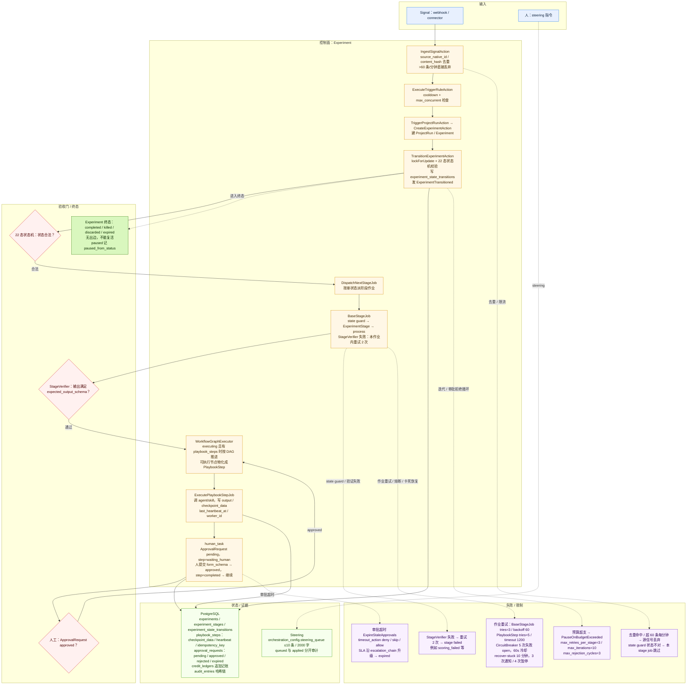
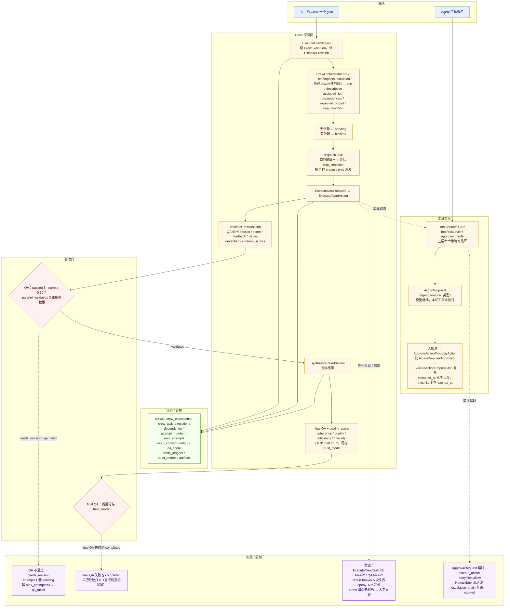

# FleetQ 到底怎么跑起来

> 依据：本地 clone `/tmp/fq-fleetq-src`（escapeboy/agent-fleet-o）的 `app/Domain/Experiment`、`Crew`、`Approval`、`Tool`、`Workflow` 和 `database/migrations`。README 说 Experiment 有 20 个状态，枚举实际 22 个，以源码为准。

## 1. 一句话

FleetQ 是一个自托管的“Agent 任务控制台”：它不替你开终端，而是把外部信号或一个目标写成数据库里的 Experiment（一次受状态机管理的自动流程）或 Crew（一组 Agent 协作完成一个目标）记录，用状态机加队列作业一段一段推进；Agent 是平台里的配置对象，产出、审批、预算、审计都落在 PostgreSQL。

## 2. 编制

- **控制面三种入口**：Livewire UI、REST `/api/v1`、MCP 工具（Model Context Protocol，给外部 Agent 调用的接口），共用同一套领域层。
- **Experiment**：核心聚合根，22 个状态，从 `draft/scoring/planning/building/awaiting_approval/executing` 到 `completed/killed/discarded/expired`。
- **Crew 角色枚举**：`coordinator / qa / worker / process_reviewer / output_reviewer / judge`。实际流程里稳定上场的是 coordinator、worker、qa，`output_reviewer` 可选；`process_reviewer` 和 `judge` 更像预留席位（创建时只记录有没有 process reviewer，adversarial 的最终裁决由 coordinator 合成，不是独立 judge 进程）。
- **Crew 的 7 种跑法**：sequential、parallel、hierarchical、self_claim、adversarial、fanout、chat_room。
- **coordinator 不是常驻进程，是一次 LLM 调用**：把 goal 拆成 JSON 任务数组（title、description、assigned_to、dependencies、expected_output、skip_condition），第二遍把 0 基下标重映射成 UUID。
- hierarchical 每轮由 coordinator 决定下一步；adversarial 每个 worker 领一个假设互相质疑，最后合成；chat_room 有轮次和收敛检测。
- **常驻的是 Horizon（Laravel 的队列管理器）进程和数据库**；agent、crew execution 都是一次性运行。agent 可以被多个 crew 复用，coordinator 也可以 `assigned_to="self"` 自己干。
- **载体**：Agent 可以绑云端 provider，也可以绑本地 Codex / Claude Code；每个 crew member 可以单独覆盖模型和工具白名单。

## 3. 一次任务从开始到结束

先看自动 Experiment 路径：

1. Signal 从 webhook / connector 进来，`IngestSignalAction` 按 `source_native_id` 或 `content_hash` 去重，超过 60 条/分钟直接丢弃。
2. TriggerRule 匹配后，`ExecuteTriggerRuleAction` 先做 cooldown 和 `max_concurrent` 检查，再由 `TriggerProjectRunAction` 创建 ProjectRun，并顺手 `CreateExperimentAction` 建 Experiment；项目有 workflow 就直接进 executing，否则进 planning。之后 `TransitionExperimentAction` 在事务里锁行、过 `ExperimentStateMachine` 校验、写 `experiment_state_transitions`、发出 `ExperimentTransitioned` 事件。
3. `DispatchNextStageJob` 监听事件，按新状态派 `RunScoringStage / RunPlanningStage / RunBuildingStage / ExecuteOutbound` 等作业。
4. 每个阶段都是一个 `BaseStageJob`：先做 state guard（状态不对就跳过），再建 `ExperimentStage`，跑 `process()`，然后调用 `StageVerifier`；验证失败最多在本作业内重试 2 次，错误会塞进下一轮 prompt。
5. 如果进入 executing 且已有 `playbook_steps`，`WorkflowGraphExecutor` 按 DAG 推进；每个可执行节点物化成一条 `PlaybookStep`，由 `ExecutePlaybookStepJob` 调 agent/skill，写 output、checkpoint、heartbeat。
6. 需要人时，`human_task` 节点会调 `CreateHumanTaskAction`，写一条 `ApprovalRequest`（`status=pending`），把 step 置为 `waiting_human`，工作流就停在这里。
7. 人提交 `form_schema` 表单后，`CompleteHumanTaskAction` 把审批置 `approved`、step 置 `completed`，再让 `WorkflowGraphExecutor` 继续。
8. evaluating 之后要么 `completed`，要么 `iterating` 重来；`completed` 是终态，之后只收集 artifact 和质量分。

Crew 路径更短：

1. 人给 goal，`ExecuteCrewAction` 建 `CrewExecution`，派 `ExecuteCrewJob`。
2. `CrewOrchestrator.run` 调 `DecomposeGoalAction` 拆任务：无依赖的 `pending`，有依赖的 `blocked`。
3. 按 process type 派发；`dispatchTask` 先算依赖输出、评估 `skip_condition`，再派 `ExecuteCrewTaskJob`。
4. `ExecuteCrewTaskJob` 调 `ExecuteAgentAction` 执行，完成后派 `ValidateCrewTaskJob`。
5. QA 返回严格 JSON：`passed / score / feedback / issues / unverified / criterion_scores`。passed 和 score 都过 0.70 才算 `validated`；否则 `needs_revision`，`canRetry()` 就回 `pending`、attempt+1，超过 `max_attempts`（默认 3）变 `qa_failed`。
6. 收敛条件满足后（`all_validated` / `threshold_ratio` / `quality_gate` / `any_validated`），`SynthesizeResultAction` 合成，再做一次 final QA，算 `quality_score`，置 `completed`。

## 4. 任务和状态记在哪

- **PostgreSQL 17 + pgvector**。核心表：`experiments`、`experiment_stages`、`experiment_state_transitions`、`playbook_steps`、`approval_requests`、`crews`、`crew_executions`、`crew_task_executions`、`credit_ledgers`、`audit_entries`、`artifacts`。
- **谁能写**：Experiment 状态只能走 `TransitionExperimentAction`，里面 `lockForUpdate` + 状态机 + 前置条件校验；playbook step 由 job 写；审批由 action 写；预算用追加式 `credit_ledgers`，reservation → release/deduction。
- **终态**：`completed / killed / discarded / expired` 没有任何出边，不能复活。`paused` 记 `paused_from_status`，恢复回原状态。失败态（`scoring_failed` 等）可以重试回原阶段，但受 `max_retries_per_stage=3`、`max_iterations=10`、`max_rejection_cycles=3` 限制。
- **CrewTaskStatus 的终态**只有 `validated / qa_failed / skipped`；`blocked` 不是终态，只是在等依赖。`crew_task_executions` 有 `depends_on uuid[]`、`attempt_number`、`max_attempts`、`qa_score`、`input_context/output`。
- **恢复**：`playbook_steps` 有 `checkpoint_data`、`last_heartbeat_at`、`worker_id`、`idempotency_key`；`tasks:recover-stuck` 命令扫描超时的 running/queued，重派阶段，3 次通知、4 次自动暂停。

## 5. Agent 之间怎么通信

主通道是事件和队列，不是聊天：

- `ExperimentTransitioned` 事件驱动下一阶段作业，正常路径不轮询。实时观察走 Reverb WebSocket；`ProjectScheduler` 仍是 cron，TimeGate 靠 `PollWorkflowTimeGatesCommand`，所以不是纯事件驱动。
- **Crew 内的消息**落 `crew_agent_messages` 表，有 sender、recipient、round、message_type；chat_room 用轮次和收敛检测，adversarial 用共享的辩论轮次。
- **人给运行中的 Experiment 发指令**：`SteerExperimentAction` 写 `orchestration_config.steering_queue`（最多 10 条、2000 字），`SteeringInjection` 中间件在下一次 LLM 调用前按顺序消费并删除；queued 和 applied 分开审计。
- MCP 工具调用带 `deadline_ms`（100ms–600s），错误码区分 retryable 和 `retry_after_ms`。
- **等待不是 agent 阻塞**，而是数据库里的 pending/waiting_human 加上队列里的延迟作业。

## 6. 怎么判断“干完了”

- **任务级**：QA agent 按任务标题/描述匹配 rubric（评分表），返回 passed + score + unverified；阈值默认 0.70。开启 `parallel_validation` 后会独立跑 3 轮，按多数票和均分聚合，记录 `agreement_ratio`；QA 输出解析不了按失败处理。
- **Crew 级**：合成后再跑 final QA，算 coherence/quality/efficiency/diversity 四项质量分（0.3/0.3/0.2/0.2），再标 `trust_mode`（single_agent / majority_consensus / full_consensus / llm_judge）。注意：final QA 失败不会阻止 `completed`，只把分数打 0，这是“完成”判定上的一个漏洞。
- **Experiment 级**：每个阶段有 `StageVerifier`。比如 `ExecutingVerifier` 检查输出不是只有 error/model_tier，且满足 `expected_output_schema`；`BuildingVerifier` 检查有 artifact 或非空输出、没有 error 字段。验证失败重试 2 次后阶段 failed。
- **人工闸门**：`ApprovalRequest` 有 pending/approved/rejected/expired，HumanTask 带 `form_schema`。Workflow 还有一条服务端硬规则：T4 分支到 `bitbucket_pr_merge` 必须经过 HumanTask，`GraphValidator` 直接拒绝不合规的图。
- **证据**：`output_snapshot`、artifacts、`qa_feedback`、`audit_entries`、`execution_result`。它不是文件证据，而是数据库行加事件。
- **什么算没干完**：Experiment 没到 completed、CrewTask 没到 validated/skipped、step 还在 waiting_human、任务 qa_failed 或 blocked。

## 7. Agent 跑在哪、能碰什么

- 平台跑在 Laravel + Horizon 队列 worker；Agent 可以是云端 provider，也可以是本地 CLI（Codex / Claude Code）。
- **工具权限**：`ToolRiskLevel`（safe/read/write/destructive）+ `approval_mode`（auto/ask/deny）；`CrewMember` 的 config 里有 `tool_allowlist`、`max_steps`、`max_credits`，是成员级白名单和成本上限。
- **命令策略五层取最严**：平台 → 组织 → 工具 allowed_commands → 项目 → Agent；平台永久阻断 `rm -rf /`、`mkfs`、管道进解释器、`$()` 等，敏感路径（`~/.ssh`、`/etc/shadow`）阻断，破坏性 SQL 不硬拒但强制人工。
- **代码执行沙箱是另一条路径**：`DockerSandboxDriver` 用 `--network none`、`--cap-drop ALL`、`--read-only`，worktree 只读挂载；Modal 驱动用 gVisor。但 `AgentSandboxOrchestrator` 允许 `network=bridge`，`bash_sidecar`（启用时）接 bridge 网络，默认 `bash_sandbox_mode` 是 `php`（进程内）。所以“隔离”取决于部署配置，不是默认就有的安全边界。
- **租户隔离**靠 `TeamScope` + 四十多张表的 PostgreSQL RLS（行级安全），MCP 按 team 隔离。

### 审批不是挂起，是“当时不执行、批准后重放”

这是 FleetQ 最反直觉的一点。工具调用被 `ToolApprovalGate` 拦下时，**模型这一轮不会暂停**：平台创建一条 `agent_tool_call` 类型的 `ActionProposal`，然后立刻给模型返回“等待审批，工具没有运行”，让模型继续往下走。人批准后，`ApproveActionProposalAction` 发 `ActionProposalApproved` 事件，监听器派 `ExecuteActionProposalJob`，用保存的 payload 在新的作业里精确重放这次调用，结果写在 proposal 上。

所以它不是“挂起—恢复”，而是“拒绝执行—留档—重放”。好处是不用保持一次 LLM 回合的连接；代价是模型当场看不到工具结果，而且必须处理审批过期、参数漂移和重复执行（作业用 `executed_at` 原子认领，`tries=1`，执行前还会再检查 `expires_at`）。

## 8. 卡住、失败、换人怎么办

- **作业重试**：`BaseStageJob` tries=3 / backoff 60；`ExecutePlaybookStepJob` tries=5，backoff 10/30/60/120 秒，timeout 1200 秒；`ExecuteCrewTaskJob` tries=2；QA job tries=2。
- **中间件**：`CheckKillSwitch`（killed 跳过，paused release 60 秒）、`CheckBudgetAvailable`、`EnforceExecutionTtl`（默认 120 分钟）、`EnforceExecutionDepth`（50）、`EnforceConcurrencyLimit`（每用户 5，超限 release 30）、`WithoutOverlapping(experimentId)`。
- **熔断**：`CircuitBreaker` 按 provider 维护 closed/open/half_open，5 次失败后打开，冷却 60 秒，半开成功才闭合。
- **卡死恢复**：`tasks:recover-stuck` 默认 10 分钟；阶段重派，3 次通知、4 次暂停。`StuckDetector` 识别 `state_oscillation`、`repeated_stage_failure`、`tool_call_loop`、`progress_stall`、`budget_drain`，默认动作是 pause 或 notify。
- **换人**：没有真正的“交接给另一个 agent”。Crew 里靠重新派发同一任务（同一个 agent），或 self_claim 模式下另一个 agent 用 `ClaimNextTaskAction` 的 `lockForUpdate` 认领；没有租约过期、没有 fencing token，`tasks:recover-stuck` 也不会扫 `crew_task_executions`，所以认领后进程崩溃，任务会停在 assigned/running，只能人工重跑整个 crew execution。
- **审批超时**：`ExpireStaleApprovals` 按 `timeout_action`（deny/skip/allow）处理；HumanTask 到 SLA 沿 `escalation_chain` 升级，最后 expired。
- **预算超支**：`PauseOnBudgetExceeded` 自动暂停；`ProjectScheduler` 连续失败 3 次也会暂停。

## 9. 这套舰队的真正特点

1. 它把“舰队”做成数据库状态机 + 队列作业：可靠、可审计、可多租户，但 agent 没有持续会话，谈不上真正的上下文交接，只能靠 checkpoint 和压缩。
2. 审批是“拒绝后重放”，不是挂起：省连接，但模型感知是断的，参数版本和幂等必须自己兜住。
3. 验证以 LLM-as-judge 为主，有 rubric 和分数，但有主观性；final QA 失败不阻断 completed，是明显的“假完成”风险。
4. 权限体系很厚（风险分级、策略、五层命令、审计哈希链），但默认可执行环境并不等于安全沙箱，隔离要按部署方式判断。
5. 体量大、运维重，适合平台化、多租户、长流程；不适合单机小舰队。

## 10. 对我们的 3 点启发

1. “完成”必须写成状态机终态 + 证据字段 + 独立验证作业，不能接受 agent 口头完成；同时要规定“验证失败不能进入终态”。
2. 审批可以用“记录提案 → 批准 → 重放”代替挂起，但必须把 replay 语义、过期、幂等和参数版本写清楚，否则批准的动作可能和模型当时看到的不是一回事。
3. 把预算、频率、风险上限放进每次动作前的策略评估，而不是 prompt 里提醒；但策略要默认开启，且“拒绝/降级”要可审计。

## 11. 关键文件索引

- `app/Domain/Experiment/States/ExperimentTransitionMap.php`
- `app/Domain/Crew/Services/CrewOrchestrator.php`
- `app/Domain/Crew/Actions/ValidateTaskOutputAction.php`
- `app/Domain/Tool/Services/ToolApprovalGate.php`
- `app/Domain/Approval/Jobs/ExecuteActionProposalJob.php`
- `app/Domain/Workflow/Services/GraphValidator.php`

## 12. 详细流程图

> 下图只使用本文 1–11 节已核对源码的事实；节点中的文件、状态值、阈值与失败原因均可在正文或源码索引中找到出处，未核实的细节不画。

FleetQ 有两条独立入口（Experiment 和 Crew），画在一张图里会变成两条并排的竖链、字被压得很小；所以主图只画 Experiment，Crew 路径在 12.2 单独画。

### 12.1 Experiment 主路径

### 12.2 Crew 路径与工具审批

