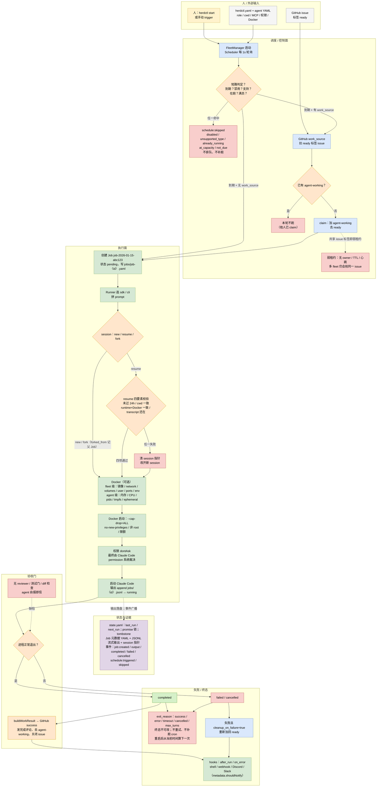

# herdctl：单机上的无人值守 agent 调度器

> 依据：源码 clone `edspencer/herdctl`（commit `0c0a1b3`，2026-10-25），重点读 `packages/core` 的 scheduler、job-executor、state 与 config schema。

## 1. 一句话

herdctl 更像“给 Claude Code 用的 cron 加工作队列”，而不是一支会互相协作的舰队。它把每个 agent 写成一份 YAML，到点就拉起来跑一个 Job，跑完落盘；agent 之间没有层级、没有派活协议。所谓 fleet，是“同一台机器上共用一套配置和状态的多个配置单元”。真正让它转起来的是调度器、Job 执行器和 `state.yaml` 三件套。

## 2. 编制

- 常驻的是 agent 配置：名字、`identity.role`、系统提示、工作目录、MCP/插件、权限、Docker 选项。没有强类型角色，role 只是提示文字。
- 临时的是 Job：每次触发新建一个，跑完进终态。同一个 agent 可以有多个 schedule，`instances.max_concurrent` 默认 1，所以多数 agent 同一时刻只跑一个 Job。
- 没有 supervisor agent、reviewer agent、审批 agent；层级只有 FleetManager → agent → Job。Job 可以从旧 session fork 出来，但那是上下文分叉，不是把任务转交给另一个 agent。
- super-fleet 只是配置合并：把多个子 fleet 的 agent 组合起来，不是运行时的多机集群。

## 3. 一次任务从开始到结束

1. `herdctl start` 启动 FleetManager，读取根 `herdctl.yaml`，加载各 agent 配置，Scheduler 每秒轮询。
2. interval/cron 到点后先做短路判断：schedule 是否禁用、类型是否支持、是否已在跑、是否达到并发上限，最后才看时间到没到。任一不满足就发 `schedule:skipped`，原因可能是 disabled、unsupported_type、already_running、at_capacity、not_due；不排队，也不补跑。
3. 如果配了 GitHub work_source，就去拉带 `ready` 标签的 issue；claim 的动作是“加 `agent-working`、去掉 `ready`”。发现已有 `agent-working` 就认为被别人抢了，本轮不跑。
4. 创建 `job-2026-01-15-abc123`，状态 pending，写 `jobs/job-<id>.yaml`。
5. Runner 选择 sdk 或 cli 运行时，拼 prompt，决定新 session、resume 还是 fork；然后启动 Claude Code，边跑边把输出 append 到 `jobs/<id>.jsonl`，状态转 running。
6. 进程结束，Job 进 completed/failed/cancelled，并记录 exit_reason，取值为 success、error、timeout、cancelled、max_turns。终态不可再改。
7. 如果来自 GitHub，按 runnerResult.success 给 issue 发完成评论、去掉 `agent-working`；success 还会直接关闭 issue。失败且 `cleanup_on_failure` 为真时，重新加回 `ready`。
8. 触发 after_run / on_error hooks，按事件过滤、按 agent 写的 metadata 条件决定是否发 shell、webhook、Discord 或 Slack。最后从当前时间算下一次触发。

## 4. 任务和状态记在哪

- `state.yaml` 记每个 agent/schedule 的 last_run、next_run 等。读改写用 per-file promise 锁串行化；删除 schedule 会留 tombstone，防止在途任务把已删配置写回来。
- 每个 Job 一份 YAML 记元数据，一份 JSONL 记流式输出；session 指针单独存。
- 只有 FleetManager/Runner 进程写这些文件。agent 本身不写 Job 状态，最多写一个 `metadata_file` 供 hook 判断。
- 失败表示得很直接：`failed` 加 `exit_reason`，没有 attempt 字段，也没有自动重试。要重来就人工 trigger，或者 fork 一个新 Job。

## 5. Agent 之间怎么通信

基本不通信。它们共享的只有三样东西：GitHub issue 的标签状态、`.herdctl/` 下的文件、以及可被 resume/fork 的 session。事件（job:created/output/completed/failed/cancelled、schedule:triggered/skipped）主要外发给 web dashboard、聊天连接器和 hooks，不是 agent 间的消息总线。

唯一的“协作”是弱租约：谁先把 issue 打成 `agent-working` 谁干。没有 owner 字段、没有 TTL、没有心跳，所以只适合单个 fleet；两个 fleet 同时跑仍可能抢同一个 issue。resume 是接着原 session 说，fork 是从原 session 分叉出一个新 Job，二者都靠 session id 和转录文件，不是消息投递。

## 6. 怎么判断“干完了”

没有独立验收。硬标准只有“进程正常退出”，然后 `buildWorkResult` 把退出成功映射成 GitHub 的 success，发评论并关闭 issue。也就是说 agent 自己说干完了，herdctl 信；没有 reviewer、没有测试门、没有 diff 检查。hooks 里的 `metadata.shouldNotify` 也只是 agent 自报，不是验证。

## 7. Agent 跑在哪、能碰什么

默认就是本机当前用户权限，能碰到的文件和网络就是你的。可选 Docker：agent 级只能配安全项（内存、CPU、pids、tmpfs、ephemeral 等），镜像、network、volumes、user、ports、env 只能在 fleet 级配。原因是 agent 配置就在它自己的工作目录里；如果 agent 能改自己的配置，就能给自己加 `network: host` 或挂敏感卷。

Docker 启动时自动 `--cap-drop=ALL`、no-new-privileges、非 root、限额。权限模式推荐无人值守用 `dontAsk`，未在白名单里的工具直接拒绝而不是挂起；但 herdctl 自己不执行权限裁决，最终仍是 Claude Code 的 permission 系统。

## 8. 卡住、失败、换人怎么办

- 失败即终态：不重试，不补跑错过的 cron，重启后从当前时间算下一次。
- 已完成的 Job 不能改；要“接着干”就 resume 原 session，要“另开一条线”就 fork，`forked_from` 记父 Job。
- resume 前校验四件事：session 未过期（默认 24h）、工作目录一致、runtime/Docker 上下文一致、CLI transcript 还在。任一失败就清指针、开新 session；服务端报 session 不存在时也会清指针重试一次。
- 没有“换人”机制：agent 是配置，不是可替换的工人。要换模型或角色，改配置重启。

## 9. 这套东西的真正特点

- 强在“把无人值守跑通”：调度、并发上限、状态落盘、会话恢复、hooks 外发，都是最小可用件。
- 弱在“没有协作”：没有任务派发、没有审查、没有 agent 间消息，只有共享 issue 标签。
- 状态是单机文件，用 promise 锁串行化，适合一台机器，不适合多机。
- GitHub claim 是弱租约，无 TTL、无 owner、无心跳，多 fleet 会抢。
- 失败没有退避和重试，可靠性靠人盯。

## 10. 对我们的启发

能用的有三样：Job 五态加 exit_reason 作为终态最小集；“进程退出”和“业务验收”必须分开，不能像它一样混为一谈；Docker 的“安全项/危险项”两级 schema 和 agent 名正则，是配置层防越权的好模板。schedule 的 skip 语义也值得借：满员就明确跳过并广播原因，不要悄悄排队。

不要学它的弱租约和无重试。如果我们要多 worker，claim 必须带 token、TTL 和心跳，否则就是给并发挖坑。

## 11. 关键文件索引

- `packages/core/src/scheduler/scheduler.ts`：跳过判定与触发
- `packages/core/src/runner/job-executor.ts`：session resume/fork 与执行
- `packages/core/src/state/schemas/job-metadata.ts`：Job 五态与 exit_reason
- `packages/core/src/work-sources/adapters/github.ts`：label claim/release
- `packages/core/src/config/schema.ts`：Docker 两级配置

## 12. 详细流程图

> 下图只使用本文 1–11 节已核对源码的事实；节点中的文件、状态值、阈值与失败原因均可在正文或源码索引中找到出处，未核实的细节不画。

