# apra-fleet：真正意义上的舰队控制平面

> 依据：源码 clone `Apra-Labs/apra-fleet`（commit `8a46d59`，2026-10-23），重点读 supervisor、workflow journal、member reservation 与 permissions 组合逻辑。

## 1. 一句话

apra-fleet 是这批项目里最像“控制平面”的：它把多台机器注册成 member，用 MCP 工具向任意 member 派 prompt 或命令，用一个持久的 workflow 程序编排十几个角色，再用 supervisor 的预留台账和看门狗保证同一台机器不会被两个冲刺同时占用。它不是让 agent 自由聊天，而是用代码把“谁在什么时候干什么”钉死。

## 2. 编制

- 三层：Fleet（控制面）→ Member（一台机器加项目目录加一个 provider CLI）→ Session（member 上的对话线程）。
- 常驻的是 fleet server 和 supervisor；member 是注册进来的资源，本地子进程或远程 SSH。
- 角色是文件不是进程：planner、plan-reviewer、doer、reviewer、deployer、integ-test-runner、regression-test-runner、ci-watcher、harvester。每个角色一份 md，frontmatter 给工具白名单，另配一份输出 JSON Schema。
- 一个物理 member 可以兼任多个角色，由 roleMap 指定；但同一时刻只能接一个 dispatch，靠 in-flight busy 锁。一个冲刺里可以有多个 doer 并行，角色内部的 member 锁再保证同一 member 不被两个角色同时用。
- 没有“LLM 经理”。编排是 workflow 脚本，不是某个 agent 的即兴决定。

## 3. 一次任务从开始到结束

以旗舰 workflow fleet-sprint 为例：

1. 操作者执行 `apra-fleet workflow fleet-sprint --issue <epic> --members dev,qa --branch ...`，或向 supervisor 发 `POST /api/sprints`。
2. supervisor 先校验 issue id、branch、roleMap、member 是否就绪，再查预留台账和 fleet server 的 `reservedBy`，有重叠直接 409，不启动任何东西。
3. 生成 sprintId，在 `reservations.json` 里一次原子写入 member 集合和 issue 根集合（两个轴同锁步），然后 `spawn(..., {detached:true})` 一个 `bin/cli.mjs` 子进程跑冲刺。子进程不随 supervisor 退出而死。
4. workflow 引擎按十二个 phase 跑：Ensure Sprint Branch → Plan → Replan → Develop → Review → Deploy → Integ Test → Re-Review → Final Review → Regression Test → Harvest → Publish PR。
5. 每个 phase 调 `dispatchRole`，选 member，发 MCP `execute_prompt`：带 member_name、model 档位、timeout_s、max_total_s、sprint_id、resume/fork、输出 schema。server 先查 `reservedBy` 是否属于本 sprint，再查 busy 锁和上下文余量，才真正起 CLI 或往活 session 里发消息。
6. planner 用 `bd` 写 bead DAG；doer 领 bead 干活；引擎重新读 bd，确认哪些 bead 真的 closed，只把“引擎确认关闭”的集合交给 reviewer。reviewer 返回 APPROVED 或 CHANGES_NEEDED，并带 reopenIds、replanIds、newTasks；改 bead 的是引擎，不是 reviewer。
7. 测试、部署、收尾、发 PR；冲刺终态时释放预留，journal 落盘。

## 4. 任务和状态记在哪

- 真正的任务账本是 beads（`bd`）里的 DAG，存在 git 仓库里；parent-child 分组，blocks 定顺序。
- 冲刺级状态在 supervisor 的预留台账 `reservations.json`：key 是 sprintId，value 是 members、issueRoots、childPid、branch/base/goal。members 和 issueRoots 必须同时 claim、同时 release，磁盘写入用临时文件加 rename，重启后从磁盘恢复。
- member 级状态在 fleet server 的 `reservedBy` 字段：哪个 sprint 占着这台机器。
- 执行历史有两层：workflow 的 JSONL journal（可选开启）和 supervisor 的 old_runs/状态文件。
- 谁能写：编排器或引擎写台账和 journal；doer 通过 `bd` 改 bead，但引擎会回读验证；reviewer 被明确禁止直接改 bead。失败用类型化 reason 表示，例如 busy、reserved、dispatch_failed、max_turns_exhausted、permission_denied、stalled，而不是一句“出错了”。

## 5. Agent 之间怎么通信

- 主通道是 MCP 工具调用，不是自由聊天。客户端调 `execute_prompt`，server 把 prompt 发给 member；member 的回复作为工具结果返回，或通过活 session 的 `respond_to_message({reply_to, content})` 按 msgid 配对。
- 事件面：`report_status` 报 online/idle，`notifications/claude/channel` 推给 orchestrator，supervisor 的 `/state`、watchdog 三信号、fleet event 供 dashboard 看。
- 共享介质：beads 数据库、git 远端、预留台账、journal。角色之间的上下文交接靠显式 session id 的 resume/fork，不靠广播。
- 阻塞式：一次 `execute_prompt` 会等到回复或超时；长任务用 `task_id` 加 `monitor_task` 去读 status.json、PID 和日志。

## 6. 怎么判断“干完了”

这批项目里验收最硬：

- 每个角色有输出 schema，reviewer 必须给 APPROVED 或 CHANGES_NEEDED，doer 必须给 status 加 closedIds。
- 关闭的 bead 不是 doer 说了算，引擎重新读 bd 验证。
- 集成测试、回归测试、deploy smoke test 都是独立角色执行；deploy 失败不得 PASS。
- 但这不是人工验收：最终产物是一个 PR，合并由人决定；没有 deploy.md 时 deploy 和 integ 会干净跳过，冲刺仍算跑完。
- journal 里“已开始但未结束”的活动只发 `journal:ambiguous` 警告，不自动判定成功。

## 7. Agent 跑在哪、能碰什么

- 跑在 member 上：本地子进程或 SSH 远程，工作目录是项目目录；不是容器沙箱，能碰的是该用户能碰的。
- 权限是“编译出来的”：`compose_permissions` 把角色 base profile、技术栈探测、tags、项目 permissions.json 合成唯一 allow list，再写进各 provider 的原生配置文件，例如 Claude 的 `.claude/settings.local.json`、Codex 的 `.codex/config.toml`。写完读回比对，全部落地才更新台账。
- `dry_run: true` 只返回“如果写会得到什么 allow list”，不写任何文件。反应式授权前先用 dry_run 判断某个 grant 是否在策略内；auto/bypass 下的 safety classifier 拒绝和 policy_deny 永不自动授权。永久 denylist 包括 sudo/su、`bash -c`、`eval`、nc/nmap、`chmod 777`、`Bash(*)`，以及带管道或命令替换的 payload。
- 密钥走 out-of-band credential store，`{{secret.NAME}}` 只在少数服务端参数里解析；execute_prompt 明文拒绝 secret token。JWT 的 workspace_id 是硬隔离边界。

## 8. 卡住、失败、换人怎么办

- busy 锁不是一拒了之：拒绝前先探 PID，确认进程死了就自愈释放，不确定就当 busy。
- 预留没有自动过期，卡死要靠 `force_release` 或 supervisor 的 restart reconciliation；这是它比真租约弱的地方。
- 看门狗六态：running-healthy、paused、running-unresponsive、crashed、finished、launch-failed。PID 复用用命令行 marker 校验；只看不杀，unresponsive 交给人。
- journal replay：续跑时按“序号、类型、member、prompt 哈希”算 key，成功的活动直接返回、不重复派发；遇到第一个不匹配就切回实时执行。已经开始但没结束的活动不猜。
- 孤儿 claim 回收：重读 bead、杀活进程、用 `--if-status in_progress` 状态守卫写入；重试前把未推提交 pin 到 `fleet-salvage/`，pin 失败就拒绝 reset。
- 换人不是运行中自动发生的：roleMap 在冲刺启动时定死，要换 member 得重启冲刺、重新走预留。

## 9. 这套东西的真正特点

- 真正把“控制平面”和“执行面”分开了：supervisor 管生命周期，member 只负责跑，状态有唯一账本。
- 幂等做得深：原子台账、journal replay、push landed 校验、孤儿回收，都是为“崩了以后还能接着跑”。
- 权限不是 prompt 里的一句嘱咐，而是编译成 provider 原生配置并读回验证。
- 代价是重：强依赖 beads、Dolt、git，角色和 workflow 与软件工程领域绑死，换领域要重写。
- 预留仍是“手动释放”的锁，不是带 TTL 的租约；单 supervisor 进程加本地盘，规模有上限。

## 10. 对我们的启发

最值得抄的是四件事：终态用类型化 reason 而不是自由文本；任务关闭必须由引擎回读验证，不能信 agent 自报；预留台账两轴同锁步加原子写；journal 的 replay key 设计，即序号、类型、member、prompt 哈希，支持部分回放。

权限的 dry_run 和“grant 前先查策略”也直接可用。不要照搬它的体量和 beads 耦合，也别把 workflow 脚本当沙箱。

## 11. 关键文件索引

- `packages/apra-fleet-se/src/supervisor/ledger.mjs`：两轴预留台账
- `packages/apra-fleet-se/src/supervisor/watchdog.mjs`：六态看门狗
- `packages/apra-fleet-workflow/src/workflow/journal.mjs`：journal 与 replay key
- `src/tools/member-reservation.ts`：reserve/release/force_release
- `packages/apra-fleet-se/fleet-sprint/runner.js`：十二 phase 编排

## 12. 详细流程图

> 下图只使用本文 1–11 节已核对源码的事实；节点中的文件、状态值、阈值与失败原因均可在正文或源码索引中找到出处，未核实的细节不画。

```mermaid
flowchart TD
  subgraph H["人 / 外部输入"]
    H1["操作者：apra-fleet workflow fleet-sprint<br/>--issue 〈epic〉 --members dev,qa --branch ..."]:::human
    H2["或 POST /api/sprints"]:::human
  end

  subgraph C["调度 / 控制面（supervisor）"]
    C1["预检<br/>issue id / branch / roleMap / member 就绪"]:::control
    C2{"预留台账 + reservedBy<br/>有重叠？"}:::gate
    C3["409：不启动任何东西"]:::fail
    C4["生成 sprintId"]:::control
    C5["spawn(detached:true) bin/cli.mjs<br/>子进程不随 supervisor 退出"]:::control
    C6["workflow 引擎 12 phase<br/>Ensure Sprint Branch → Plan → Replan → Develop<br/>→ Review → Deploy → Integ Test → Re-Review<br/>→ Final Review → Regression Test → Harvest → Publish PR"]:::control
    C7["dispatchRole：选 member<br/>MCP execute_prompt（model / timeout_s / max_total_s<br/>sprint_id / resume-fork / 输出 schema）"]:::control
    C8{"server 校验<br/>reservedBy 属本 sprint？<br/>busy 锁？context headroom？"}:::gate
    C9["busy：先探 PID<br/>进程死→自愈释放；不确定→busy"]:::fail
    C10["失败用类型化 reason<br/>busy / reserved / dispatch_failed<br/>max_turns_exhausted / permission_denied / stalled"]:::fail
    C11["恢复 / 幂等机制<br/>journal replay key：序号 + 类型 + member + prompt 哈希<br/>孤儿回收：重读 bead / 杀活进程 / --if-status in_progress<br/>pin fleet-salvage/；pin 失败拒绝 reset<br/>watchdog 六态：running-healthy / paused / running-unresponsive<br/>crashed / finished / launch-failed"]:::state
  end

  subgraph S["状态与证据"]
    S2["reservations.json<br/>sprintId → members + issueRoots + childPid<br/>+ branch/base/goal；两轴同锁步，tmp+rename"]:::state
    S1["其他状态与权限<br/>fleet server reservedBy（哪个 sprint 占着机器）<br/>journal JSONL / old_runs / 状态文件（journal 可选开启）<br/>compose_permissions：角色 profile + 技术栈 + tags + permissions.json<br/>→ .claude/settings.local.json / .codex/config.toml；读回比对<br/>dry_run 只返回 allow list，不写文件"]:::state
  end

  subgraph E["执行面（member）"]
    E1["planner：bd 写 bead DAG<br/>parent-child 分组 / blocks 定序"]:::exec
    BD1["beads 任务账本（bd，存 git 仓库）"]:::state
    E2["doer：领 bead 干活<br/>返回 status + closedIds"]:::exec
    E2R["引擎回读 bd<br/>只把“引擎确认 closed”的集合交给 reviewer"]:::gate
    E3["reviewer<br/>APPROVED / CHANGES_NEEDED<br/>reopenIds / replanIds / newTasks"]:::exec
    E3B["引擎按 review 结果改 bead<br/>reviewer 不直接改 bead"]:::control
    E4["integ-test / regression-test / deploy smoke<br/>独立角色执行；deploy 失败不得 PASS"]:::exec
    E5["harvest + Publish PR"]:::exec
  end

  subgraph F["失败 / 终态"]
    F1["冲刺终态<br/>释放预留（members + issueRoots 同锁步）"]:::success
    F2["预留无 TTL：force_release / restart reconciliation<br/>换 member：重启冲刺、重走预留<br/>roleMap 在启动时定死"]:::fail
    F4["PR 已发布，等待人合并"]:::human
  end

  subgraph G["验收门"]
    G1["验收事实<br/>角色输出 schema：doer=status+closedIds；reviewer=APPROVED/CHANGES_NEEDED<br/>引擎回读 bd，只认引擎确认 closed；reviewer 不直接改 bead<br/>deploy 失败不得 PASS；无 deploy.md → deploy/integ 干净跳过，仍算跑完<br/>journal 已开始未结束 → journal:ambiguous 警告，不自动判成功<br/>最终产物是 PR，合并由人决定"]:::gate
  end

  H1 --> C1
  H2 --> C1
  C1 --> C2
  C2 -->|"是"| C3
  C2 -->|"否"| C4
  C4 --> S2
  S2 --> C5
  S2 -.->|"member 级 / 权限 / 历史"| S1
  C5 --> C6
  C6 --> C7
  C7 --> C8
  C8 -->|"是"| E1
  C8 -.->|"busy"| C9
  C8 -.->|"校验失败"| C10
  C6 -.->|"journal / 恢复"| C11
  E1 --> BD1
  BD1 --> E2
  E2 --> E2R
  E2R --> E3
  E3 -->|"APPROVED"| E4
  E3 -.->|"CHANGES_NEEDED"| E3B
  E4 --> E5
  E5 --> F1
  E5 -.->|"验收事实"| G1
  F1 --> F4
  F1 -.->|"限制"| F2

  classDef human fill:#fff2cc,stroke:#d6b656,color:#000
  classDef control fill:#dae8fc,stroke:#6c8ebf,color:#000
  classDef exec fill:#d5e8d4,stroke:#82b366,color:#000
  classDef state fill:#e1d5e7,stroke:#9673a6,color:#000
  classDef gate fill:#ffe6cc,stroke:#d79b00,color:#000
  classDef fail fill:#f8cecc,stroke:#b85450,color:#000
  classDef success fill:#d5f0c8,stroke:#5a9e3a,color:#000
```

