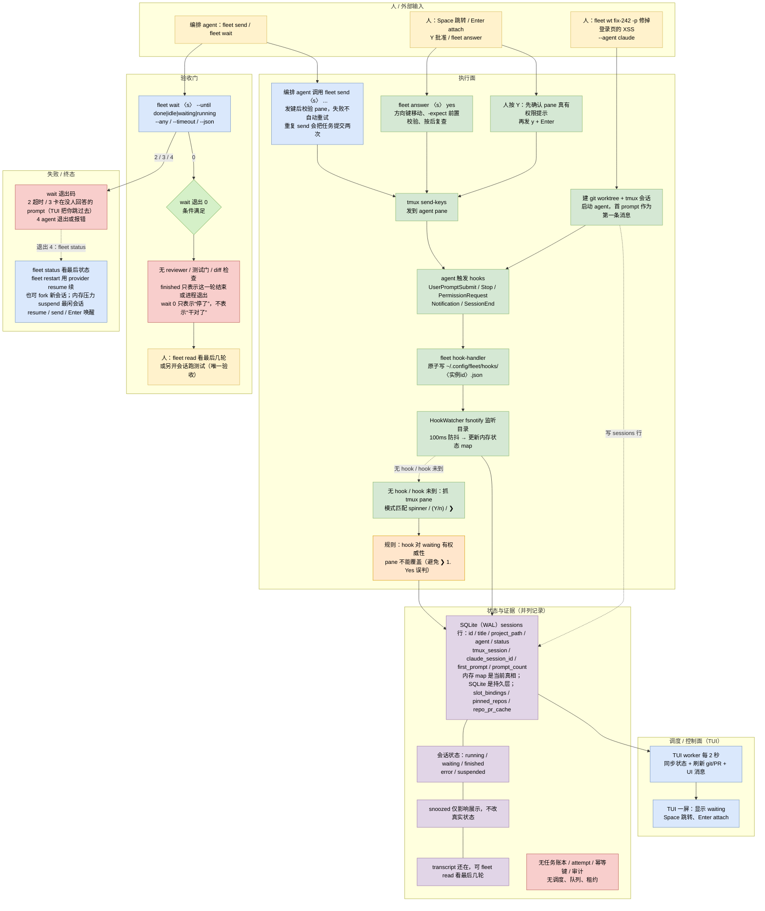

# fleet TUI：不是控制平面，是人机注意力路由

> 依据：源码 clone `brizzai/fleet`（commit `1b13ff2`，2026-10-20），重点读 hooks、session 状态机、SQLite 存储与 `fleet wait`。

## 1. 一句话

brizzai/fleet 不是“多 agent 舰队”，而是一个终端驾驶舱：每个 coding agent 跑在独立 tmux 里，fleet 把它们的状态汇总到一块屏上，让你按 Space 跳到正在等你的那个。它不派活、不排队、不验收，组织方式就是“一堆并列的会话加一个人”。

## 2. 编制

- 没有角色、没有层级。一个 session 等于一个 agent CLI、一个目录或 git worktree、一个分支、一条首 prompt。
- 常驻的是 TUI 进程和 tmux 会话；临时的是每次 `fleet wt` 新建的 worktree 会话。会话可以 suspend/resume，SQLite 里一直有行。
- 人可以同时开很多会话，也可以让一个 agent 通过 `fleet` CLI 或 SKILL 去创建和指挥别的会话。此时“编排者”是那个 agent 或人，fleet 只提供工具面。
- 同一个会话不能兼任两个角色，因为没有角色这回事。

## 3. 一次任务从开始到结束

1. `fleet wt fix-242 -p "修掉登录页的 XSS" --agent claude`：建 git worktree、起 tmux、启动 agent、把 prompt 作为第一条消息，写 SQLite 的 sessions 行。
2. agent 干活。Claude Code 的 UserPromptSubmit、Stop、PermissionRequest、Notification、SessionEnd hooks 触发 `fleet hook-handler`，handler 把状态原子写到 `~/.config/fleet/hooks/<实例id>.json`。
3. fsnotify watcher 监听这个目录，100ms 防抖，更新内存里的状态 map；TUI 的 worker 每 2 秒做一轮同步、git/PR 刷新和 UI 消息。
4. 没有 hook 的 agent，或者 hook 还没到时，抓 tmux pane 做模式匹配：spinner、`(Y/n)`、`❯`。规则是 hook 对 waiting 有权威性，pane 不能把它覆盖，避免把 “❯ 1. Yes” 误判成已完成。
5. 人看到 waiting，按 Space 跳过去，Enter attach；按 Y 前先确认 pane 上真有权限提示，再发 `y` 加 Enter。也可以 `fleet answer <s> yes`，它用方向键移动、按前校验、按后复查。
6. 另一个 agent 可以 `fleet send <s> "..."` 追加指令，再 `fleet wait <s> --until idle` 阻塞等待。
7. 会话结束进 finished；transcript 还在，可以 `fleet read` 看最后几轮，`fleet restart` 用 `--resume` 续，或 fork 一条新会话。

## 4. 任务和状态记在哪

- SQLite（WAL）的 `sessions` 表：id、title、project_path、agent、status、tmux_session、claude_session_id、first_prompt、prompt_count 等；另有 slot_bindings、pinned_repos、repo_pr_cache 等辅助表。
- 实时状态还有两份：hook 写出的 JSON 状态文件，和 HookWatcher 的内存 map。SQLite 是持久层，内存 map 是当前真相。
- 谁能写：fleet 进程写 SQLite；hook-handler 写状态文件；agent 本身完全不知道 fleet 存在。没有任务账本、没有 attempt、没有幂等键。
- 失败表示成 `error` 或进程退出；`snoozed` 只影响展示，不改真实状态。

## 5. Agent 之间怎么通信

- 单向为主：agent 通过 hooks 告诉 fleet“我在干什么”，fleet 通过 tmux 发键或 `fleet send` 告诉 agent“继续”。没有 agent 之间的直接消息。
- 共享介质是文件系统和 worktree；两个会话如果指向同一目录会互相踩，所以 `fleet add` 明确警告不要和正在编辑的树共用目录。
- 对外的可编程接口是 `fleet wait`：`--until done|idle|waiting|running`，加 `--any`、`--timeout`、`--json`。退出码 0 表示条件满足，2 表示超时，3 表示卡在没人回答的 prompt，4 表示 agent 退出或报错。文档明确说不要轮询 status，wait 就是为此设计的。
- `fleet send` 交付后会校验 pane，失败不自动重试；重复 send 会把任务提交两次，所以失败先看 last prompt。

## 6. 怎么判断“干完了”

没有验收。`finished` 只表示 agent 这一轮结束或进程退出；`fleet wait --until done` 的 0 也只表示“它停了”，不表示“干对了”。人要自己 `fleet read` 看最后几轮，或另开会话跑测试。没有 reviewer、没有测试门、没有 diff 检查。

## 7. Agent 跑在哪、能碰什么

- tmux 加 git worktree，不是容器。agent 以当前用户权限运行，能碰到的文件和网络就是用户的。
- 审批是“人肉 gate”：Y 只在 waiting 时可用，且要先确认 pane 上确有提示；`answer` 有 `-expect` 防答错 prompt；waiting（除非 `-force`）、pane 回到 shell（不可 force）、suspended 都有拒绝或唤醒规则。
- 没有密钥隔离、没有 per-agent 工具白名单、没有审计记录。Y 就是直接敲键，事后查不到谁批了什么。

## 8. 卡住、失败、换人怎么办

- 卡在审批：wait 退出 3，TUI 把你跳过去。
- agent 退出或报错：wait 退出 4；`fleet status` 看最后状态。
- 超时：wait 退出 2。
- 会话崩了：`fleet restart` 杀进程后用 provider 的 resume 续；内存压力下自动 suspend 最闲的会话，resume、send 或 Enter 唤醒。
- 没有自动换人、没有重试、没有任务重派。要换 agent，就新建一个会话，把上下文用 `fleet read` 或手写 prompt 传过去。

## 9. 这套东西的真正特点

- 强在“注意力路由”：把“哪个会话在等我”变成一眼可见、一键可达，这是多 agent 最稀缺的人机接口。
- hooks 到状态文件、fsnotify、内存 map 是一条低延迟、无轮询的状态总线，且 hook 优先于 pane 抓取，方向是对的。
- wait 的 0/2/3/4 退出码把“完成”“超时”“等人”“挂了”分开，是可编程终态的好例子。
- 它不是控制平面：没有调度、队列、租约、验收、审计、多机。
- 依赖 tmux 和全局 `~/.claude/settings.json` 注入 hook，会污染用户环境；pane 抓取是启发式，版本升级容易误判。

## 10. 对我们的启发

只借三样：wait 的四态退出码，尤其把“等人审批”单独成 3；hook 优先、pane 兜底的状态融合规则；动作前观察、动作后复查的三拍协议。不要把它当舰队内核，调度、验收、幂等、权限它都没有。

## 11. 关键文件索引

- `cmd/fleet/wait.go`：退出码与等待语义
- `internal/hooks/hook_watcher.go`：fsnotify 状态总线
- `internal/hooks/status_file.go`：状态文件格式与原子写
- `internal/session/session.go`：状态机与 pane 判定
- `internal/session/storage.go`：SQLite 会话表

## 12. 详细流程图

> 下图只使用本文 1–11 节已核对源码的事实；节点中的文件、状态值、阈值与失败原因均可在正文或源码索引中找到出处，未核实的细节不画。

