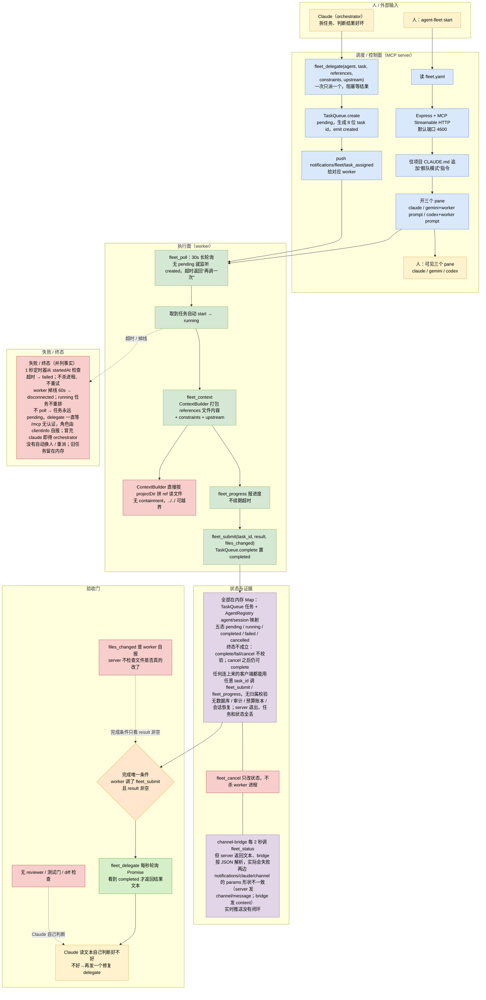

# Luxuzhou agent-fleet：可见委托原型

> 依据：源码 clone `Luxuzhou/agent-fleet`（commit `7b930b2`，2026-03-26，单提交原型），重点读 task queue、MCP 工具与 context builder。

## 1. 一句话

它是一台 MCP server：Claude Code 当 orchestrator，Gemini CLI 和 Codex CLI 当 worker，各自在一个可见 pane 里干活。它确实有“角色、派活、回传”的骨架，但只是原型：任务全在内存，没有验收、没有持久化、没有鉴权。算“可见委托”，不算舰队。

## 2. 编制

- 只有两档角色：orchestrator 和 worker。Claude 是 orchestrator，Gemini 负责设计和 UI，Codex 负责实现；分工写死在提示里，还要求 Claude 不要问用户用哪个 agent。
- 角色不是配置出来的，是 MCP initialize 时客户端自报的：`clientInfo.metadata.role` 等于 orchestrator，或者名字里带 claude，就是 orchestrator，其余都是 worker。
- 三个 pane 只是可见性，不承担调度。workerRole 只用于展示，不参与授权。
- 没有 reviewer、QA、deployer，没有层级、没有动态组队、没有并行 fan-out；`fleet_delegate` 一次只派一个任务并阻塞等结果。

## 3. 一次任务从开始到结束

1. `agent-fleet start` 读 `fleet.yaml`，起 Express 加 MCP Streamable HTTP（默认 4600），往项目 `CLAUDE.md` 追加“舰队模式”指令，再开三个 pane：claude、gemini 加 worker prompt、codex 加 worker prompt。
2. Claude 拆任务，调 `fleet_delegate(agent, task, references, constraints, upstream)`。
3. server 的 `TaskQueue.create` 建一个 pending 任务，生成 8 位 id，emit `created`，同时 push `notifications/fleet/task_assigned` 给对应 worker。
4. worker CLI 调 `fleet_poll`，这是 30 秒长轮询：先查自己有没有 pending，没有就监听 `created` 事件，超时返回“没任务，再调一次”。
5. 取到任务后自动 start 成 running；需要上下文就调 `fleet_context`，server 的 `ContextBuilder` 把 references 文件内容、constraints、upstream 打包返回；干活过程中可调 `fleet_progress`。
6. 干完调 `fleet_submit(task_id, result, files_changed)`，`TaskQueue.complete` 置 completed；`fleet_delegate` 里那个每秒查一次的 Promise 看到 completed，把结果文本返回给 Claude。
7. Claude 读文本，自己判断好不好；不好就再派一个修复任务。

## 4. 任务和状态记在哪

- 全部在内存 Map：`TaskQueue` 存任务，`AgentRegistry` 存 agent 和 session 的映射。server 退出，任务和状态全丢。
- 状态是 pending、running、completed、failed、cancelled 五态，但终态不成立：`complete()`、`fail()`、`cancel()` 都不校验当前状态，cancel 之后仍可 complete，终态会被覆盖。
- 超时由 1 秒定时器检查，从 startedAt 起算，`fleet_progress` 不续期；超时置 failed。
- 谁能写：任何连上来的客户端都能用任意 task_id 调 `fleet_submit` 或 `fleet_progress`，没有归属校验，可以改别人的任务。
- 没有数据库、审计、预算账本、会话恢复。`fleet_cancel` 只改状态，不杀 worker 进程。

## 5. Agent 之间怎么通信

- JSON-RPC `tools/call` 走 MCP Streamable HTTP；任务创建时 push 给 worker，完成、失败、进度 push `notifications/claude/channel` 给 orchestrator。
- `fleet_poll` 是长轮询，`fleet_delegate` 是 1 秒轮询，二者都不是事件驱动到底。
- `channel-bridge` 还每 2 秒调一次 `fleet_status`，想把变更推给 Claude；但 server 返回的是文本，bridge 却按 JSON 解析，实际会失败；两边 `notifications/claude/channel` 的 params 形状也不一致，server 发 `channel` 和 `message`，bridge 发 `content`。实时推送没有闭环。
- 没有消息持久化、ack、重放、去重；worker 不 poll，任务就永远 pending。

## 6. 怎么判断“干完了”

没有验收。完成的唯一条件是 worker 调了 `fleet_submit` 且 result 非空；`files_changed` 是 worker 自报，server 不检查文件是否真的改了。orchestrator 事后读文本自己判断，既没有独立 reviewer，也没有测试门。这是它最不能照搬的地方。

## 7. Agent 跑在哪、能碰什么

- 三个可见 pane，同一用户权限，没有沙箱、没有 per-agent 工具白名单。
- `/mcp` 没有认证，任何能连端口的客户端都能 initialize；角色由客户端自称，冒充 claude 就能拿到 orchestrator 工具。
- worker 可以用任意 task_id 提交或改进度，越权改别人的任务；`ContextBuilder` 直接按 projectDir 拼 ref 读文件，路径没有 containment，`../../` 可以越界。
- `.claude/settings.local.json` 只对四个 `fleet_*` 工具做本地 allow，不构成强制边界。

## 8. 卡住、失败、换人怎么办

- worker 掉线：60 秒宽限后标记 disconnected，但它 running 的任务不会重排，delegate 会一直等。
- worker 不 poll：任务永远 pending，delegate 永久挂起，delegate 自身没有超时。
- 超时：到点置 failed，但不杀进程、不重试。
- 换人：没有。要换 agent 只能由 Claude 再发一个 delegate，旧任务留在内存里。
- 进程重启：全丢，没有恢复。

## 9. 这套东西的真正特点

- 骨架清楚：角色化 MCP 工具、内存队列、可见 pane，半天能看懂全貌。
- 只有“委托”，没有“舰队”：没有验收、没有持久化、没有鉴权、没有幂等、没有终态保护。
- 优点是“可见”：人和 Claude 都能看到 worker 在 pane 里干什么，这比黑盒调度更容易建立信任。
- 缺点是“不能信”：任务可以丢、状态可以覆盖、角色可以冒充、结果可以自报。
- 它适合当教学 demo，不适合当生产依赖。

## 10. 对我们的启发

只能借“薄 MCP 角色协议加可见 pane”这个交互形态：把角色工具集做窄，把 worker 的工作过程放在人能看到的地方。其余不要学：验收、持久化、鉴权、幂等、终态、超时、归属校验，全部要重做。明确说：不要照搬。

## 11. 关键文件索引

- `src/core/task-queue.ts`：五态与超时
- `src/server.ts`：角色判定与 push
- `src/tools/orchestrator.ts`：阻塞 delegate
- `src/tools/worker.ts`：poll、context、submit
- `src/core/context-builder.ts`：上下文打包与越界风险

## 12. 详细流程图

> 下图只使用本文 1–11 节已核对源码的事实；节点中的文件、状态值、阈值与失败原因均可在正文或源码索引中找到出处，未核实的细节不画。

